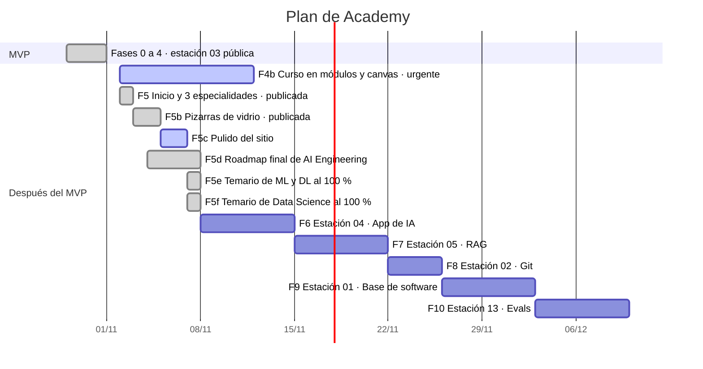

# Avance · Academy

El tablero del proyecto. Claude lo actualiza en cada entrega:
- marca lo hecho con [x], con la fecha;
- suma tu pedido al registro del final;
- cambia «Dónde estamos».

Si te pierdes, abre este archivo o pregunta «¿cómo vamos?».

*Última actualización: 2026-11-07*

---

## Dónde estamos

- **Avance:** `▓▓▓▓▓▓▓░░░` 75 de 97 tareas del plan (77 %). El MVP está al 100 %. Las fases 5 y 5b están publicadas, de la 5c van 4 de 6, y las 5d (roadmap final), 5e (temario de ML y DL) y 5f (temario de Data Science) están terminadas.
- **Hecho:** Fases 0 a 5b y casi toda la 4b. **Desde el 2026-11-04, el sitio público** (https://academy.woorky.app/es/) **tiene dos temas, claro y oscuro:** blanco o negro con auroras minimalistas en los colores del logo y pizarras de vidrio. También lleva el logo del sol en la barra de arriba, el ícono del sitio y esos colores en algunos textos, sin morado. El diseño de antes de Glassboards sigue en el worktree `UIv1` (`~/projects/UIv1`). **Para el roadmap final**, roadmapv2 a roadmapv6 ya están guardados en `docs/roadmap/`, y ya decidiste qué entra de roadmapv4: se construye dirigiendo al LLM, sin código a mano. **La versión 2 de la propuesta del roadmap final está lista** en `docs/roadmap/propuesta-roadmap-final.md`: tronco común, dos caminos (Productos o Modelos) y cierre de CEO y CTO, con 115 lecciones y tu sistema multi-agente como proyecto. **Desde el 2026-11-07, el sitio público muestra el temario v3:** AI Engineering con 126 lecciones, fundamentos y agentes para todos, y al final dos caminos (Productos e Investigación) con desvíos graduales a ML y DL; ML y Deep Learning es un curso propio de 57 lecciones. **El 2026-11-07, todo quedó en GitHub, en `main`**, igual que el sitio publicado, con los 3 temarios (AI Engineering, ML y DL, y Data Science) y sus documentos en `docs/roadmap/` (pedido 105); el PR #13 figura como mezclado.
- **Falta:** reordenar las fases 6 a 10 según los 3 temarios publicados y escribir las lecciones desde fuentes originales. Sumar 2 videos a tu biblioteca. Terminar el pulido (5c).
- **Lo próximo:** elegir la primera lección para escribir. Propuesta: «ML engineer, data scientist y los demás», que tiene su ficha lista con 16 fuentes.

**Cómo ver el avance:** cada respuesta de Claude en el chat termina con este resumen y con la carta Gantt de abajo. El tablero completo siempre está en https://github.com/francoSW99/Academy/blob/main/AVANCE.md.

## Plan de acción

```text
                                      oct S1  S2  S3  S4  S5  S6  S7
F0–4  MVP: estación 03 pública        ███
F4b   Curso en módulos + canvas           █████▓
F5    Inicio + 3 especialidades           ███
F5b   Pizarras de vidrio                      ██
F5c   Pulido + logo + 2 fondos                  ▓▓
F5d   Roadmap final de AI Engineering     ████████
F5e   Temario de ML y DL al 100 %            █████
F5f   Temario de Data Science                █████
F6    Lección 04 · App de IA                      ░░░░
F7    Lección 05 · RAG                                ░░░░
F8    Lección 02 · Git                                    ░░
F9    Lección 01 · Base de software                         ░░░░
F10   Lección 13 · Evals                                        ░░░░
Después: 06–08 agentes · temas de ML y DS · inglés · UI             ···

█ hecho · ▓ lo próximo · ░ lo que viene
S1 = 2–8 nov · S2 = 9–15 · S3 = 16–22 · S4 = 23–29 · S5 = 30 nov–6 dic · S6 = 7–13 dic · S7 = 14–20 dic
```

Cada sesión es un día de trabajo con Claude. El plan supone unas 3 por semana y se ajusta cada semana.

### Por qué este orden

1. **Sigue los 5 niveles de la nota.** Las estaciones 03 y 04 cierran el nivel 1, «App con API». La 05 y la 13 cierran el nivel 2, «RAG con evals». La mayoría del trabajo útil en producción es de nivel 2 o 3.
2. **La 02 (Git) va antes que la 01.** Su material ya está escrito en la guía de estudio, y es lo que usas a diario con los agentes.
3. **Lo que faltaba del bloque 3 entra donde se usa:**
   - las salidas estructuradas, en la 04;
   - los embeddings, en la 05;
   - el tool use, en la 06.
4. **La fase 5d va antes que las lecciones.** El roadmap final puede cambiar el orden y el contenido de las fases 6 a 10. Sus fechas dependen de cuándo lleguen tus fuentes.

### Decisiones que te tocan

1. **¿Apruebas este plan?** Si quieres otro orden, dime cuál y lo cambio.
2. ✅ **¿Cuánto código escribe quien sigue el roadmap?** Decidido el 2026-11-04 (pedido 75): nada a mano. Se aprende construyendo, pero dirigiendo al LLM con lenguaje técnico, y se enseña con pseudocódigo o flowcharts en vez de código exacto. El detalle está en `docs/roadmap/README.md`.
3. **¿Las copias de las fuentes del roadmap van a GitHub?** Academy es público y son textos de terceros, así que las dejé fuera de git y solo existen en la VM. Recomiendo seguir así y, si quieres respaldo, copiarlas en BrainFran, que es privado.
4. **¿Entra el sexto punto de roadmapv4?** Experiencia resolviendo el problema de un tercero y networking real. Está en el índice, pero no te lo mostré en el chat.
5. **¿Apruebas la propuesta de roadmap final?** Son 54 lecciones en 11 módulos, y reemplaza las fases 6 a 10 por olas de publicación. Su sección 13 trae 8 decisiones, incluidas la 3 y la 4 de esta lista, cada una con mi recomendación.

### La carta Gantt con fechas (en GitHub se ve como gráfico)



---

## Plan del MVP (hecho)

El detalle de cada fase está en [docs/plan-mvp.md](docs/plan-mvp.md).

### ✅ Fase 0 · Bases del repo · 4 de 4 · 2026-10-29
- [x] Repo público en GitHub: https://github.com/francoSW99/Academy · 2026-10-29
- [x] Proyecto Next.js que genera un sitio estático (lo sirve Caddy, sin servidor nuevo) · 2026-10-29
- [x] El plan guardado en `docs/plan-mvp.md` · 2026-10-29
- [x] Script `npm run publicar`: arma el sitio y lo cambia de una vez, sin versiones a medias · 2026-10-29

### ✅ Fase 1 · Diseño · 4 de 4 · 2026-10-30 · PR #1
- [x] Tres primeras propuestas: A «Libro vivo», B «Universo» y C «Metro» · 2026-10-29
- [x] Tres vueltas más con tus comentarios: D, E y F · 29 y 30 de octubre
- [x] Elegiste **F · Pizarra en metro, en blanco**. Es una interfaz *provisional*: se rediseña después · 2026-10-30
- [x] `DESIGN.md` con colores, letras y movimiento, y las maquetas en `docs/diseno/` · 2026-10-30

### ✅ Fase 2 · Estructura del curso · 4 de 4 · 2026-10-30 · PR #2
- [x] Portada con el mapa de metro: Línea 1, 5 zonas y 16 estaciones. La Línea 2 se ve «en revisión» · 2026-10-30
- [x] Cada estación con sus 7 paradas: problema, mecanismo, criterio, cómo falla, sin la etiqueta, dirígelo y práctica · 2026-10-30
- [x] El avance se guarda en el navegador, sin login: paradas vistas y práctica hecha · 2026-10-30
- [x] La ruta como datos (`src/ruta/`): para abrir una estación se agrega su archivo de contenido · 2026-10-30

### ✅ Extra · Videos animados con ManimGX · 3 de 3 · 2026-10-30 · PR #3
- [x] ManimGX instalado, la herramienta de animación al estilo 3Blue1Brown · 2026-10-30
- [x] Tres videos de la estación 03 (paradas 1, 2 y 5), en pizarra blanca y negra · 2026-10-30
- [x] Script que los renderiza: `scripts/escenas.sh` · 2026-10-30

> Retirados del sitio el 2026-10-31 (pedido 28): las lecciones no llevan videos para mirar. ManimGX se queda para dibujar las piezas de los canvas (Fase 4b).

### ✅ Fase 3 · Lección del bloque 3 · 5 de 5 · 2026-10-31 · PR #4 y #5
- [x] **Córtalo en tokens** (parada 2):
  - cualquier texto cortado en tokens;
  - el español usa más tokens según el modelo: +69 % en GPT-3 y solo +4 % en GPT-4o.
  - 2026-10-31
- [x] **Tira los dados** (parada 2):
  - temperatura, top-k y top-p con probabilidades reales;
  - el modelo apuesta 48 % a Estambul, que es falso, como capital de Turquía.
  - 2026-10-31
- [x] **Llena la ventana** (parada 4):
  - una conversación que no cabe;
  - al recortar o resumir, el modelo olvida la alergia al maní.
  - 2026-10-31
- [x] **Lee rápido, escribe lento** (parada 3):
  - prefill y decode con tiempos reales;
  - un documento tarda 4 min 33 s en dar el primer token en esta máquina.
  - 2026-10-31
- [x] Práctica del bloque (parada 7): explicar por qué alucina un modelo y marcarla como hecha · 2026-10-30

### ✅ Fase 4 · Publicar · 3 de 3 · 2026-10-31
- [x] Cambiar el Caddyfile (`BrainFran/tools/academy/Caddyfile`): `/` lleva a `/es/` y `/obsidian/` queda igual · 2026-10-31
- [x] Armar la versión con `npm run publicar` y reiniciar el servicio `brainfran-academy` · 2026-10-31
- [x] Probar en internet: `/es/`, las 7 paradas, los videos, las escenas desde el celular y `/obsidian/` · 2026-10-31

---

## Fases después del MVP

### ▶ Fase 4b · Curso en módulos y lecciones, con canvas y videos de tu biblioteca · urgente · 12 de 13 · PR #7 a #10 mezclados
Pedidos 28 a 33. Los 3 videos de la estación 03 los hice yo con ManimGX para mirarlos, y eso no va. Las reglas:
1. **Nada de videos para mirar.** Lo que mostraban va como **canvas interactivo** y entretenido, como un gráfico o un dashboard que responde en tiempo real.
2. **ManimGX se queda, y se usa para los canvas**, al estilo de 3Blue1Brown.
3. **Nada se crea al abrir la página**, para que cargue rápido. ManimGX dibuja antes, en la VM, las fórmulas, los diagramas y los momentos. La página solo junta esas piezas y mueve con Motion lo que tocas. Meta: menos de 300 KB por canvas (el video de la parada 2 pesa 815 KB).
4. **Los videos que van en la app salen, cuando se pueda, de tu biblioteca de BrainFran** (`04-Biblioteca/Videos/`). Tocas la miniatura y el video se ve dentro de la app, o abres el enlace directo a YouTube. Van solo donde suman. Cada video, o el tramo que se muestra, trata solo del tema de la lección: los videos generales no van en una lección (pedido 41).
5. **Sin paradas** (pedido 33): el curso se ordena en módulos y lecciones, como DeepLearning.AI o Khan Academy.
6. **La lección se lee de corrido** (pedidos 35 y 37). Las ideas van en orden, cada una con su explicación, su escena y su ejemplo real en el mismo texto, sin recuadros que corten el hilo. Al final van los consejos de un ingeniero de IA experto, uno por idea. Es para aprender el criterio de un ingeniero de IA, no para redactar prompts simples.
7. **Visual, pero solo lo necesario** (pedidos 38, 39, 47 y 48): cada idea lleva un visual (diagrama, escena o canvas). Si ya tiene una escena, no se le suma un diagrama. Cada diagrama usa los ejemplos de la misma lección, no trae códigos ni números que haya que buscar en otra parte y no adelanta temas que todavía no se explicaron. Los diagramas van en HTML (el texto se lee en el celular y cargan al instante). ManimGX queda para las figuras matemáticas y los canvas.
8. **Ejemplos de ingeniero de IA** (pedido 40): los ejemplos y casos son usos reales y cotidianos de un ingeniero de IA (código, soporte, costos, RAG), medidos con un modelo. Nada de casos básicos o vagos.
9. **Fuentes** (pedido 42): cada idea y cada consejo dicen en qué se apoyan, y la lista completa va al final, con la fecha de revisión. Primero van los libros y videos de la biblioteca de BrainFran, después los videos de canales reconocidos y las mediciones propias. Solo páginas y capítulos verificados.

- [x] Sacar del sitio los 3 videos (paradas 1, 2 y 5) y corregir las reglas: `DESIGN.md` y este tablero, de inicio a fin · 2026-10-31
- [x] Diseñar los 3 canvas con ManimGX: el storyboard de cada uno quedó en `docs/diseno/canvas/`, espera tu OK antes de construir · 2026-10-31
- [x] Estructura nueva: la portada con el temario (módulos, lecciones, avance y «Continuar»), la lección en una página con barra lateral y las direcciones viejas que redirigen. Publicado · 2026-11-01
- [x] La lección 03 de corrido: las ideas en orden, cada una con su ejemplo real dentro del texto, y al final lo que haría un ingeniero de IA experto, uno por idea (pedidos 35 y 37). Publicado · 2026-11-01
- [x] Casos reales de un ingeniero de IA en la lección 03: un bot de soporte que escribe «Ya hemos cancelado la recurrencia» sin que nadie lo hiciera, el presupuesto en tokens (el español usa un 63 % más en GPT-3), tickets que cambian de categoría o se clasifican mal con seguridad (74 %), el plan del cliente que se pierde al recortar, y el manual entero que tarda 5 min 10 s en empezar. Medidos con el modelo local, también en las escenas (pedido 40). Publicado · 2026-11-01
- [x] Videos de la lección 03 solo del tema: 3Blue1Brown y Andrej Karpathy, que tratan solo de cómo funciona un LLM, y de Marina Wyss solo el tramo del 2:45 al 8:30. BettaTech salió: solo nombra el tema de pasada (pedido 41). Publicado · 2026-11-01
- [ ] Sumar a tu biblioteca los 2 videos nuevos (3Blue1Brown y Karpathy): la sesión de NotebookLM del servidor venció, así que hace falta que vuelvas a entrar con tu cuenta
- [x] Fuentes en cada lección: cada idea y cada consejo dicen en qué se apoyan (libro con página, video con capítulo o medición propia), y la lista completa va al final, con la fecha de revisión. Las principales son el libro «Prompt Engineering for Generative AI», de tu biblioteca, y las mediciones de `lab/` (pedido 42). Publicado · 2026-11-01
- [x] Visuales solo donde hacen falta, no un flowchart por idea (pedidos 47 y 48): la lección 03 queda como en el sitio. El bucle va en la idea 1, que no tenía escena, y las ideas 2 a 5 ya tienen la suya. Los diagramas de tokens, ventana y leer/escribir se probaron en el borrador y se quitaron · 2026-11-01
- [x] Los 3 canvas con los casos nuevos (pedido 49). Dos ya estaban hechos en la escena de los dados: «Pregúntale otra vez» es «Tirar 100 veces» con los tickets, y «La pizarra por momentos» son las probabilidades, el dado y la temperatura. Hacerlos otra vez repetía lo mismo. El que faltaba es «Escribe como el bot» (idea 1): eliges cada palabra de la respuesta a Carla entre las 3 más probables y la probabilidad de la frase se multiplica en vivo. Se armó directo en HTML con los datos de `lab/autocompletado`; los storyboards viejos de `docs/diseno/canvas/` quedan solo como historia · 2026-11-01
- [x] Videos de tu biblioteca: tocas la miniatura y se ve en la app, o vas directo a YouTube. Hoy son los 3 videos del tema de la lección 03 (ver más arriba). Publicado · 2026-11-01
- [x] Publicar el curso en módulos y la lección 03 nueva, revisados en computador y celular (pedido 43) · 2026-11-01
- [x] Publicado en https://academy.woorky.app/es/leccion/03/ y revisado en computador y celular (pedido 49) · 2026-11-01

### ✅ Fase 5 · Inicio y 3 especialidades · 7 de 7 · 2026-11-02 · PR #11
Pedido 51. La plataforma se separa en 4 secciones, para no mezclar temas ni marear al estudiante:
1. **Inicio:** qué es Academy, cuál especialidad elegir y cómo se conectan.
2. **AI Engineering**, **ML y Deep Learning** y **Data Science:** cada una con su sección, su temario y su avance. Cambias de una a otra cuando quieras, desde la barra de arriba.
3. **Conectadas por dentro:** cada tema vive en una sola especialidad. Los temas compartidos son puentes entre lecciones (`src/ruta/conexiones.ts`). Al final de la lección se muestran con el color y el nombre de la otra especialidad.

- [x] Los datos: las 3 especialidades con su temario (`src/ruta/especialidades.ts`) y 18 puentes entre lecciones (`src/ruta/conexiones.ts`). Un puente roto no deja armar el sitio · 2026-11-02
- [x] El Inicio: qué es Academy, una tarjeta por especialidad («Elígela si…») y cómo se conectan · 2026-11-02
- [x] La sección de cada especialidad, con su temario y su avance, y la barra de arriba con las 4 secciones (cabe en el celular) · 2026-11-02
- [x] La lección 03 dentro de AI Engineering (`/es/ai-engineering/leccion/03/`), con «Conecta con otras especialidades» al final. Los links viejos redirigen y el avance que ya tenías se conserva · 2026-11-02
- [x] El selector de las 4 secciones en vidrio (pedidos 52 a 54). En el computador es una píldora arriba al centro. En el celular y la tablet es una manija chica en el borde izquierdo, con el ícono de la sección en la que estás: al tocarla se abre un dock vertical con las 4 secciones, y se cierra al elegir, al tocar fuera o al seguir leyendo. Así no tapa el estudio ni lo que va abajo. La sección elegida va en una burbuja blanca que se desliza al cambiar, con el ícono del color de su especialidad. Al hacer scroll, la página se ve borrosa por debajo. Usa los colores de Academy, no los de Woorky · 2026-11-02
- [x] El reparto del Pilar 2 entre ML y Deep Learning (18 lecciones) y Data Science (13), aprobado al publicar (pedido 54). En el sitio sigue marcado «Temario en preparación» hasta que se junten las fuentes · 2026-11-02
- [x] Publicado en https://academy.woorky.app/es/ (PR #11 mezclado) · 2026-11-02

### ✅ Fase 5b · Pizarras de vidrio · 4 de 4 · 2026-11-03 · PR #13
Pedidos 55 a 58. Fran descartó las propuestas anteriores (PR #12, sin mezclar), pidió aplicar línea por línea `ai_studio_code.txt` (Dark Spatial Glassmorphism) con 6 referencias de glass boards, y aprobó el resultado («Dale, me gustó»).
- **Un solo fondo** (pedido 57): las pizarras van directo sobre el fondo principal de la página, sin bases individuales. Ese fondo es el lienzo `#06080D` con 3 auras fijas (azul, añil y ámbar).
- **Toda la app, no solo las escenas:** barra flotante, temario con tu avance, lector, tarjeta de portada, prompts, callouts y navegación del final. El Inicio y las especialidades también pasan a vidrio, para que el sitio se vea parejo.
- **Siempre oscuro** y con títulos sin serif, como pide el txt. En el celular, el temario es un Glass Drawer y las secciones siguen en la manija del borde izquierdo.
- **Sin perfil ni XP:** el sitio no tiene cuentas, así que la barra muestra tu avance real. Los minutos de lectura se calculan del texto.
- Es solo CSS, sin imágenes: la página no pesa más. El sistema está en `DESIGN.md`.
- **El diseño anterior sigue a mano** (pedido 58): está en el worktree `~/projects/UIv1`, rama `UIv1`, por si quieres volver o tomar elementos de él.

- [x] Propuesta en el borrador: el txt aplicado a la lección 03 y a los componentes globales, probado de 320 a 1920 px con todas las interacciones · 2026-11-02
- [x] Tu OK a la propuesta («Dale, me gustó») · 2026-11-03
- [x] Ajustes con tu feedback: no pediste ninguno · 2026-11-03
- [x] Publicado en https://academy.woorky.app/es/ · 2026-11-03

### Fase 5c · Pulido del sitio · 4 de 6 · semana 2
- [x] Dos fondos, claro y oscuro: blanco o negro con auroras en los colores del logo, calcadas de las 2 imágenes de Fran, y vidrio en toda la app. Con botón de tema. Publicado el 2026-11-04 (pedidos 65, 66 y 69)
- [x] Colores del logo en algunos textos: una palabra del Inicio, los números, «Pruébalo» y las 3 especialidades (azul, coral y oro), sin morado. Publicado el 2026-11-04 (pedidos 67 a 69)
- [x] Logo nuevo: el sol minimalista en SVG (C con las diagonales al 75 %), en la cabecera. Publicado el 2026-11-04 (pedidos 59 a 64 y 67 a 69)
- [x] Ícono del sitio (favicon), con el logo. Publicado el 2026-11-04 (pedidos 67 a 69)
- [ ] Página «no encontrada» en español: hoy sale la de Next.js, en inglés
- [ ] Vista previa al compartir el link: título, descripción e imagen en WhatsApp o LinkedIn

**Diagnóstico de UI y UX · 2026-10-31.** Hecho con capturas del sitio en vivo, en escritorio (1440 px) y en celular (390 px). Se vuelve tareas cuando elijas A o B:
1. **Una parada es una página muy larga.** La parada 2 mide 3.000 px en escritorio y 4.000 en el celular: un video y 2 escenas dentro de una sola pizarra. `DESIGN.md` pide una idea por pizarra.
2. **En el celular no se ve en qué parada estás.** La línea de paradas muestra solo de la 1 a la 3. En la parada 6, la tuya queda fuera de la pantalla.
3. **No retoma donde quedaste.** «Entrar a la estación» siempre lleva a la parada 1, y la portada no muestra cuántas paradas viste.
4. **El video tapa su propia frase.** Los controles del video cubren la última línea de la escena («Elige por probabilidad, no por verdad»).
5. **El mapa tiene ruido para quien llega.** Las etiquetas «L2 · 27–28» salen en 8 estaciones sin explicación, y las 15 estaciones cerradas no dicen «pronto».
- Con la estructura nueva (Fase 4b) se arreglan el 2, el 3 y el 5; el 4 ya se fue con los videos.
- Detalles menores: la cabecera ocupa 2 filas en el celular, falta el selector «Blanca | Negra» que pide `DESIGN.md` y la portada dice «1 abierta(s)».

### Fase 5d · Roadmap final de AI Engineering · 10 de 10 ✅ · semanas 1 y 2
Se juntan roadmaps de otros ingenieros y otras fuentes, y se combinan con el temario actual para llegar desde cero a ingeniero de IA experto. Ninguna fuente externa es la fuente de verdad. Todo está en `docs/roadmap/`.
- [x] Guardar roadmapv2 · 2026-11-04 (pedido 71)
- [x] Guardar roadmapv3, el PDF de BASWE · 2026-11-04 (pedido 72)
- [x] Guardar roadmapv4, 3 videos de tu biblioteca · 2026-11-04 (pedidos 73 y 74)
- [x] Guardar roadmapv5, 5 proyectos con repos, y comprobar repos y artículos · 2026-11-04 (pedido 76)
- [x] Investigar temarios de instituciones confiables y guardarlos como roadmapv6 · 2026-11-04 (pedido 77)
- [x] Juntar las fuentes: roadmapv2 a roadmapv6 · 2026-11-04 (pedido 78)
- [x] Combinarlas con el temario actual en una propuesta de roadmap final: `docs/roadmap/propuesta-roadmap-final.md` · 2026-11-04 (pedido 78)
- [x] Versión 2 de la propuesta, con tu feedback y una investigación en 7 frentes · 2026-11-05 (pedido 80)
- [x] Tu OK al índice v3 (dos caminos dentro de AI Engineering) y publicado en el sitio · 2026-11-07 (pedido 88)
- [x] Aplicarla al temario de Academy: el sitio (`src/ruta/temario.ts` y `src/ruta/conexiones.ts`), la nota de BrainFran y `docs/roadmap/propuesta-roadmap-v3.md` · 2026-11-07 (pedidos 88 y 90)

### Fase 5e · Temario de ML y Deep Learning al 100 % · 9 de 9 ✅ · semanas 1 y 2
Mejorar el temario de ML y DL hasta que sea completo y profesional, con el mismo proceso que AI Engineering. Todo está en `docs/roadmap/ml-dl/`.
- [x] Prepararse: diagnóstico del temario actual (57 lecciones), huecos, fuentes listas y método · 2026-11-07 (pedido 92)
- [x] Sumar fuentes: diplomado PUCV, libros de ML y DL de BrainFran y las 38 skills de NeuralWorks, en `docs/roadmap/ml-dl/mapa-de-skills.md` · 2026-11-07 (pedido 93)
- [x] Tus 9 decisiones, más R y la regla de no profundizar dos veces: `docs/roadmap/ml-dl/feedback.md` · 2026-11-07 (pedido 94)
- [x] Investigar en qué se diferencian un ML engineer y un data scientist, y repartir los temas: `docs/roadmap/ml-dl/ml-vs-ds.md` · 2026-11-07 (pedido 94)
- [x] Propuesta v1: 109 lecciones de ML y DL más 8 repasos, dos salidas y 2 proyectos, y el esqueleto de Data Science: `docs/roadmap/ml-dl/propuesta-ml-v1.md` · 2026-11-07 (pedido 94)
- [x] Investigar más a fondo en la web la diferencia entre ML engineer y data scientist (MIT, Stanford, Berkeley, CMU, Google, Microsoft, AWS y Coursera): 16 fuentes y 4 ajustes propuestos en `ml-vs-ds.md` · 2026-11-07 (pedido 95)
- [x] Propuesta v2: la investigación aplicada (4 ajustes), Research con «tu primer estudio» y las dos ramas obligatorias, 110 lecciones, la lección de roles con sus 16 fuentes, y todo guardado en BrainFran: `docs/roadmap/ml-dl/propuesta-ml-v2.md` · 2026-11-07 (pedido 96). En el pedido 97 se reestructuraron los proyectos: sin el optativo de la suciedad, con «tu primer estudio» como mini-proyecto y con 3 proyectos grandes en Research (deporte, neurociencia y biomecánica)
- [x] Tu OK a la v2, con 2 lecciones más de biomecánica (112 en total), y subida al borrador con Data Science y sus repasos · 2026-11-07 (pedido 98)
- [x] Publicado en el sitio (ML y DL con 112 lecciones, y Data Science), en la nota de BrainFran y en la propuesta · 2026-11-07 (pedido 99)

### Fase 5f · Temario de Data Science al 100 % · 6 de 6 ✅ · semanas 1 y 2
Mejorar el temario de Data Science con el mismo proceso que ML y DL. Todo está en `docs/roadmap/ds/`.
- [x] Prepararse e investigar: el esqueleto actual (24 lecciones), 9 temarios de Data Science verificados (Harvard, Berkeley, Stanford, HarvardX, DeepLearning.AI, Google y la PUCV), 10 huecos y las fuentes listas · 2026-11-07 (pedidos 100 y 101)
- [x] Tus 5 decisiones y la oferta de data scientist de NeuralWorks: `docs/roadmap/ds/feedback.md` · 2026-11-07 (pedido 103)
- [x] Propuesta v1: 55 lecciones, dos caminos, un proyecto por camino, cada punto de la oferta cubierto (`mapa-neuralworks-ds.md`) y 3 cambios para ML y DL; las fuentes y la oferta, guardadas en BrainFran (Búsqueda 3): `docs/roadmap/ds/propuesta-ds-v1.md` · 2026-11-07 (pedido 103)
- [x] Tu feedback: el tamaño está bien, y diferencias en diferencias pasa al tronco común · 2026-11-07 (pedido 104)
- [x] Tu OK («publica»), sin pasar por el borrador · 2026-11-07 (pedido 104)
- [x] Publicado en el sitio, con los 3 cambios de ML y DL, y en la nota de BrainFran · 2026-11-07 (pedido 104)

### Fase 6 · Estación 04 «Arquitectura de una app de IA» · 0 de 4 · semanas 1 y 2
- [ ] Las 7 paradas, con el contenido de la nota (bloque 4)
- [ ] 1 o 2 canvas interactivos con ManimGX, uno con salidas estructuradas
- [ ] Videos de tu biblioteca, solo donde suman
- [ ] Publicada en el sitio

### Fase 7 · Estación 05 «RAG y conocimiento» · 0 de 4 · semanas 2 y 3
- [ ] Las 7 paradas (bloque 5)
- [ ] 1 o 2 canvas interactivos con ManimGX: embeddings (texto → vector) y búsqueda
- [ ] Videos de tu biblioteca, solo donde suman
- [ ] Publicada en el sitio

### Fase 8 · Estación 02 «Git y GitHub para dirigir al agente» · 0 de 3 · semana 3
- [ ] Las 7 paradas, desde la guía de estudio de Git (ya escrita)
- [ ] 1 canvas interactivo
- [ ] Publicada en el sitio

### Fase 9 · Estación 01 «Base de software habilitadora» · 0 de 4 · semana 4
- [ ] Las 7 paradas (bloque 1)
- [ ] 1 o 2 canvas interactivos con ManimGX
- [ ] Videos de tu biblioteca, solo donde suman
- [ ] Publicada en el sitio

### Fase 10 · Estación 13 «Evals: saber si funciona» · 0 de 4 · semana 5
- [ ] Las 7 paradas (bloque 13)
- [ ] 1 o 2 canvas interactivos con ManimGX
- [ ] Videos de tu biblioteca, solo donde suman
- [ ] Publicada en el sitio

### Más adelante (sin fecha)
- [ ] Estaciones 06 a 08: agentes y harnesses (nivel 3), con tool use
- [ ] Inglés (`/en/`), con «traducir al tocar»
- [ ] Rediseño de la interfaz a tu gusto: la actual es provisional
- [ ] Enlaces a las notas del grafo desde cada lección (necesita un cambio en BrainFran)
- [ ] Lo que queda del bloque 3: modelos que razonan, cómo se entrena en 3 pasos y modelos abiertos vs. cerrados

---

## Registro: lo que pediste y lo que se entregó

| # | Fecha | Lo que pediste | Lo que se entregó |
|---|---|---|---|
| 1 | 2026-10-29 | Planificar la plataforma, sin tocar código | Plan en 5 fases (`docs/plan-mvp.md`) |
| 2 | 2026-10-29 | Elegir: 1.ª lección, acceso, idiomas y diseño | 1.ª lección «Cómo funciona un LLM», pública sin login, español primero, y mockups para elegir |
| 3 | 2026-10-29 | «Dale fase 1, repo público» | Repo público, base del proyecto (Fase 0) y propuestas A, B y C |
| 4 | 29 oct | Más minimal y futurista, como DeepMind o Woorky, con la letra de Woorky, en claro y oscuro | Propuesta D «Metro minimal», en claro y en oscuro |
| 5 | 29 oct | Más elegante, como una pizarra digital (3Blue1Brown, Khan Academy); la portada se entendía poco | Propuesta E «Pizarra digital» |
| 6 | 30 oct | El estilo de E con el orden de metro de C | Propuesta F «Pizarra en metro» |
| 7 | 2026-10-30 | «F pero en blanco, pizarra» | F en blanco elegida y `DESIGN.md` (PR #1) |
| 8 | 2026-10-30 | Que la interfaz sea provisional y se priorice el curso | Anotado: colores cambiables en un solo lugar |
| 9 | 2026-10-30 | «Dale mezcla» | PR #1 mezclado |
| 10 | 2026-10-30 | «Dale fase 2» y «Continúa» | Mapa, estaciones, 7 paradas y avance (PR #2) |
| 11 | 2026-10-30 | Instalar ManimGX y usarlo siempre | ManimGX instalado y revisado |
| 12 | 2026-10-30 | Mezclar el PR 2 y mejorar las clases con ManimGX | PR #2 mezclado y 3 videos animados (PR #3) |
| 13 | 2026-10-30 | «Mezcla el PR 3» | PR #3 mezclado |
| 14 | 2026-10-31 | «Dale fase 3» | Escena «Tira los dados» |
| 15 | 2026-10-31 | «Sigue» | Escena «Córtalo en tokens» |
| 16 | 2026-10-31 | «Sigue» | Escena «Llena la ventana» |
| 17 | 2026-10-31 | «Mezcla el PR 4» | PR #4 mezclado |
| 18 | 2026-10-31 | «Sigue» | Escena «Lee rápido, escribe lento» (PR #5) |
| 19 | 2026-10-31 | «Mezcla el PR 5» | PR #5 mezclado: Fase 3 completa |
| 20 | 2026-10-31 | Un archivo para seguir el avance, porque estabas perdido | Este tablero, `AVANCE.md` (PR #6) |
| 21 | 2026-10-31 | Ver el tablero cada vez que se termina un trabajo y recibir el resumen «Dónde estamos» | El link fijo al tablero y el resumen al final de cada entrega (PR #6) |
| 22 | 2026-10-31 | Ver el avance aquí, en el chat de Claude Code, en cada respuesta | Cada respuesta termina con «Dónde estamos». Un hook de Claude Code le pasa este tablero a Claude en cada mensaje tuyo |
| 23 | 2026-10-31 | «Mezcla el PR 6» | PR #6 mezclado: el tablero queda en `main`, con link fijo |
| 24 | 2026-10-31 | «Dale publica todo» | Sitio público en https://academy.woorky.app/es/ (Fase 4). MVP terminado |
| 25 | 2026-10-31 | Saber qué camino sigue y ver el plan siempre claro, tipo carta Gantt | Plan de acción F5–F10 con carta Gantt en el tablero y al final de cada respuesta |
| 26 | 2026-10-31 | Ver «Dónde estamos» y la carta Gantt en cualquier proyecto, no solo en Academy | Hook global de Claude Code: en cada repo lee su `AVANCE.md`, y si no hay, pide crearlo |
| 27 | 2026-10-31 | Trabajar ahora en la UI y la UX: «prepárate» | Diagnóstico del sitio en vivo (escritorio y celular): 5 problemas de uso y la decisión A o B |
| 28 | 2026-10-31 | Sacar los videos que hizo Claude: lo animado va como canvas interactivo con motion, y los videos son originales de YouTube de canales educativos, solo donde suman. Un plan antes de corregir | Plan de la Fase 4b (6 pasos, unas 2 sesiones). La regla quedó anotada en la memoria de Claude |
| 29 | 2026-10-31 | «Noo desinstales ManimGX»: canvas interactivos y entretenidos, como gráficos o dashboards en tiempo real, con ayuda de ManimGX al estilo de 3Blue1Brown, pero sin crearlos en tiempo real para que la app cargue rápido. Los videos: ideas de la biblioteca de BrainFran, con vista previa y enlace directo | Plan de la Fase 4b corregido: ManimGX dibuja antes y la página solo arma y responde; tarjetas de la biblioteca. ManimGX sigue instalado (no se desinstaló) |
| 30 | 2026-10-31 | Los videos no son para sacar ideas para los canvas: solo hay que intentar sacarlos de la biblioteca de BrainFran. Al tocar la miniatura se ve el video en la app, o se va por enlace directo a YouTube | Plan de la Fase 4b corregido: paso 4, videos de la biblioteca que se ven en la app, con enlace a YouTube |
| 31 | 2026-10-31 | «Dale» al plan corregido de la Fase 4b | Paso 1 publicado: los 3 videos fuera del sitio y las reglas corregidas en `DESIGN.md` y en el tablero. Paso 2: storyboards de los 3 canvas con ManimGX y datos reales. Paso 4: videos de tu biblioteca con miniatura y enlace, sin publicar (PR #8) |
| 32 | 2026-11-01 | Cambiar el mecanismo de enseñanza de 7 paradas: ¿algún sustituto? | Tres opciones, con la recomendada: «3 paradas» (Apuesta → Descubre → Dirige) |
| 33 | 2026-11-01 | Sin apuesta ni paradas: directo al grano, como DeepLearning.AI o Khan Academy. Primero la teoría, después un ejemplo de la vida real, y cómo usarlo para ser preciso al darle un prompt a un LLM como Claude. «Tal vez módulos» | Propuesta: curso → módulos → lecciones; cada lección en una página con 3 partes. La Fase 4b pasa a 7 tareas |
| 34 | 2026-11-01 | «Dale, créalo para ver cómo queda en la página» | Borrador en https://academy.woorky.app/borrador/es/: temario por módulos y la lección 03 en 3 partes. El sitio público no cambió |
| 35 | 2026-11-01 | Los módulos sí; las 3 partes de la lección no: confunden, no se ve dónde empieza el caso real y el prompt de la parte 3 no sirve. Es para aprender el criterio de un ingeniero de IA, no para redactar prompts simples | Propuesta: la lección por ideas, con su caso real y lo que hace un ingeniero de IA, todo junto |
| 36 | 2026-11-01 | «Dale, hazlo en borrador para ver tu idea» | La lección 03 por ideas en el borrador: 5 ideas, cada una con su caso real y lo que hace un ingeniero de IA, más el resumen, la práctica, preguntas para tu LLM y los videos |
| 37 | 2026-11-01 | Los recuadros «Caso real» y «Lo que hace un ingeniero de IA» cortan el hilo del estudio; los consejos de experto sí sirven. «Proponme algo» | La lección de corrido en el borrador: el ejemplo real va dentro del texto de cada idea, y los consejos de un ingeniero de IA experto van al final, uno por idea, con un enlace de vuelta a la idea |
| 38 | 2026-11-01 | Más imágenes, gráficos, canvas o flowcharts entre los textos, para no aburrirse y poder imaginar lo que dice el texto | 2 diagramas de muestra en el borrador (el bucle de un LLM y cómo arma un ingeniero una llamada) y el plan para el resto: al menos un visual por idea |
| 39 | 2026-11-01 | El flowchart de «lo que haría un ingeniero de IA» confunde: no se entiende el ejemplo del cliente ni los números 1, 4, 5 | Quitado del borrador. Reglas para los diagramas: los ejemplos de la lección, sin códigos que buscar y sin adelantar temas |
| 40 | 2026-11-01 | Que los ejemplos y casos sean usos reales y cotidianos de un ingeniero de IA, no casos básicos y vagos | Propuesta: 5 casos de ingeniero de IA para la lección 03, medidos con el modelo local, también en las escenas |
| 41 | 2026-11-01 | Antes de aplicar: los videos de «Para profundizar» son demasiado generales para «Cómo funciona un LLM»; tienen que estar más semantizados | Propuesta: solo el tramo del tema de cada video de tu biblioteca, y 2 videos que tratan solo de cómo funciona un LLM, sumados a tu biblioteca |
| 42 | 2026-11-01 | «Dale perfecto». Y antes de implementar, citas o bibliografía con fuentes confiables, ojalá de los libros y fuentes de BrainFran | En el borrador: los casos reales medidos, los videos del tema (3Blue1Brown, Karpathy y el tramo de Marina Wyss) y las fuentes en cada idea y al final, con el libro de tu biblioteca |
| 43 | 2026-11-01 | «Dale, sí me gusta» | Publicado en https://academy.woorky.app/es/: el temario por módulos y la lección 03 nueva. Revisado en internet: la portada, la lección, los links viejos y `/obsidian/` |
| 44 | 2026-11-01 | ¿Por qué cambió el dashboard? ¿Se genera al abrir la página y gasta tokens? | No: el sitio es estático y no llama a ningún modelo (revisado en lo publicado). Cambió porque hoy se publicaron los casos nuevos. Los datos se midieron una vez con el modelo local, sin costo por visita |
| 45 | 2026-11-01 | «Mezcla el PR 7 y el 8» | PR #7 y #8 mezclados: `main` queda igual que el sitio publicado, y el link de este tablero muestra el estado de hoy |
| 46 | 2026-11-01 | «Sigue» | Los 3 diagramas que faltaban en la lección 03 (tokens, ventana, leer y escribir), en el borrador (PR #9) |
| 47 | 2026-11-01 | La escena de tokens ya le gustaba como está en el sitio: no todo tiene que ser flowchart, solo lo necesario | Quitado el diagrama de tokens: la idea 2 queda igual que en el sitio. Regla anotada: un visual solo donde la idea no tiene uno |
| 48 | 2026-11-01 | «Sí, sácalos»: la lección como está publicada | Quitados los diagramas de ventana y de leer/escribir. El código de la lección es igual al del sitio |
| 49 | 2026-11-01 | «Mezcla el PR 9, redibuja lo que falta de los 3 canvas con los casos nuevos y sube todo a prod» | PR #9 mezclado. Canvas «Escribe como el bot» en la idea 1; los otros 2 ya estaban en la escena de los dados. Publicado (PR #10) |
| 50 | 2026-11-02 | «Mezcla el PR 10»; la Fase 5, en otra conversación | PR #10 mezclado: `main` es igual al sitio. La Fase 5 sigue en una conversación nueva |
| 51 | 2026-11-02 | Reestructurar la página entera: una sección para cada especialidad (AI Engineering, ML/Deep Learning y Data Science) más un Inicio que presente la plataforma. Separadas en la interfaz y conectadas por dentro, para no confundir qué tema es de cuál | Las 4 secciones en el borrador (https://academy.woorky.app/borrador/es/), con los puentes entre lecciones. El Pilar 2 quedó repartido entre ML y DL y Data Science, a la espera de tu OK. El pulido pasa a la Fase 5b |
| 52 | 2026-11-02 | Antes de publicar, el selector de las 4 secciones en estilo glassy, como la barra de Woorky, el dock vertical y el dashboard de vidrio de sus referencias. Solo el vidrio de los botones, no los colores de Woorky | Barra de vidrio con las 4 secciones y un ícono por sección: abajo en el celular y arriba al centro en el computador. La elegida va en una burbuja blanca que se desliza. En el borrador |
| 53 | 2026-11-02 | En el celular, que el selector vaya escondido en un costado para no tapar el estudio ni lo que va abajo. En el computador, la píldora de arriba al centro le gustó | En el celular, una manija de vidrio en el borde derecho que abre un dock vertical con las 4 secciones (como su imagen del dock). El computador no cambia. En el borrador |
| 54 | 2026-11-02 | La manija del celular a la izquierda; después, mezclar y subir a producción | Manija y dock en el borde izquierdo. PR #11 mezclado y publicado en https://academy.woorky.app/es/: las 4 secciones, los puentes y el selector de vidrio |
| 55 | 2026-11-02 | La 5b distinta: cambiar el diseño de los canvas, dashboards y pizarras de las lecciones (como el tokenizador) a pizarras digitales de vidrio, con glassmorphism. Mandó 9 referencias y pidió una propuesta primero | Propuesta en el borrador: las pizarras de la lección 03 en vidrio, con dos variantes (A nocturna y B de color) y un selector para compararlas con las de hoy. El pulido del sitio pasa a la Fase 5c |
| 56 | 2026-11-02 | Ni A ni B ni Hoy: la pizarra de vidrio va encima del fondo original de la app, sin un fondo distinto | Propuesta rehecha en el borrador: las pizarras son el mismo vidrio del selector de secciones, sobre el fondo blanco (o negro en modo oscuro), y lo de adentro va en burbujas de vidrio. Selector «Vidrio | Hoy» |
| 57 | 2026-11-02 | Trabajar la UI/UX: aplicar línea por línea `ai_studio_code.txt`, ignorando el PR antiguo, con 6 referencias. Los glass boards van sobre el fondo principal de la página, sin bases individuales; lo más natural, minimalista y moderno posible | Propuesta Glassboards en el borrador (PR #13): toda la app en vidrio oscuro sobre un solo lienzo, con barra flotante, temario con avance, lector, prompts, callouts y navegación del final. Probadas todas las interacciones |
| 58 | 2026-11-03 | «Dale, me gustó»: guardar el diseño que está en prod en un worktree nuevo llamado UIv1, por si se arrepiente o quiere tomar elementos de él, y actualizar el sitio a la versión del borrador | Worktree `~/projects/UIv1` con el diseño anterior, comprobado idéntico a lo publicado. Glassboards publicado en https://academy.woorky.app/es/ y probado en vivo |
| 59 | 2026-11-03 | Mejorar el logo con el MCP de Kling: partir de su sol con degradado y llevarlo a un logo minimalista y moderno de startup de IA (tipo Grok, Gemini o Claude), manteniendo el sol, los colores y el degradado suave | 8 propuestas en 4 direcciones, comparadas en https://academy.woorky.app/borrador/logo/ y en `docs/diseno/logo/opciones-tanda-1.png`, con pruebas a 64, 32 y 16 px. Costó 148 créditos de Kling. Falta que elija una; después se redibuja en SVG |
| 60 | 2026-11-03 | Le gustan A2 y D1. Probar otra pintura: que el rojizo y el azul no se separen en diagonal, sino azul en la base y rojizo en las puntas o al revés, sin morados | Las dos siluetas repintadas con un degradado radial, en las dos direcciones. El paso de un color a otro va por celeste, crema y dorado. Comprobado: 0 % de píxeles morados. No gastó créditos de Kling |
| 61 | 2026-11-03 | «La primera versión está perfecta»: se queda con las de base rojiza, A2 y D1 | Guardadas tal cual en `docs/diseno/logo/elegidos/`, en PNG y SVG. El SVG difiere 0,17 % o menos del PNG. La prueba con la mezcla más suave quedó descartada |
| 62 | 2026-11-04 | No subir nada sin que lo pida. Cambiar solo la geometría de los rayos de D1 para que parezcan rayos de sol, manteniendo el minimalismo y la separación | 3 formas de rayo (A Lanza, B Cuña, C Llama) mostradas en el chat y guardadas en `docs/diseno/logo/elegidos/`, sin subir nada. El hueco entre rayos se mantiene o crece. Falta que elija una |
| 63 | 2026-11-04 | D1 y C son los grandes candidatos. Hacer las diagonales más chicas que las cardinales, para que se parezca más a un sol | Las 4 diagonales achicadas desde su base en D1 y C, probadas al 80, 70, 60 y 50 %. Mostradas en el chat al 70 y al 60 %, y guardadas en `docs/diseno/logo/elegidos/`, sin subir nada. Falta que elija una |
| 64 | 2026-11-04 | El logo será C con las diagonales al 75 %. No implementarlo todavía: seguir con la UI, sobre todo cambiando el fondo, y esperar sus instrucciones | Logo final en `docs/diseno/logo/logo-academy.svg` y `logo-academy.png` (2048 px, fondo transparente). Comprobado: 8 rayos, cardinales iguales a C, diagonales al 75,0 % y 0 % de píxeles morados. No entró al sitio. A la espera de las instrucciones del fondo |
| 65 | 2026-11-04 | Dos fondos, claro y oscuro, estilo Aurora, Glow y Mesh Gradient, con los colores del logo, manteniendo el vidrio. Mandó 4 imágenes de referencia | Primer intento con un shader y la rampa del logo: tapaba la pantalla de color. Fran lo descartó en el pedido 66 |
| 66 | 2026-11-04 | «Los dos originales están mejor»: blanco y negro como color principal, auroras minimalistas con 3 o 4 colores del logo y sus 2 imágenes como referencia, para no hacer ruido con textos y canvas | Formas calcadas de sus imágenes, con su mismo tipo de vidrio. Tema claro para toda la app, botón de tema y todo el texto sobre vidrio. Contraste AA medido sobre el peor píxel. Los dos fondos pesan 15 KB cada uno. Le gustó el resultado |
| 67 | 2026-11-04 | Integrar el logo y poner los colores del logo en algunos textos, sin morado y sin que la plataforma se vea colorida: elegante, moderna y minimalista | Logo en la barra de arriba y en el ícono del sitio. Coral en una palabra del Inicio, los números y «Pruébalo»; especialidades en azul, coral y oro; fichas y consejos con colores del logo. 0,00 % de morado visible en las pantallas medidas. En local, sin subir ni commit |
| 68 | 2026-11-04 | Subirlo al borrador | En https://academy.woorky.app/borrador/es/. Comprobado en vivo en 5 páginas, en claro y en oscuro: logo, fondo, botón de tema y enlaces, sin archivos faltantes. La página vieja `/borrador/logo/` se conservó y el sitio público no cambió |
| 69 | 2026-11-04 | «Me encanta. Publica» | Publicado en https://academy.woorky.app/es/ (versión `20261104-032158`). Comprobado en vivo en 5 páginas, en claro y en oscuro: logo, fondo, botón de tema, enlaces e ícono, sin archivos faltantes. La versión anterior sigue guardada para volver atrás. El borrador dejó de estar en línea, como en cada publicación. El código sigue sin commit |
| 70 | 2026-11-04 | Mejorar el roadmap de AI Engineering, contenido y orden de estudio, para llegar desde cero a ingeniero de IA experto. Por ahora, solo contexto | Leí el temario del sitio y el Pilar 1 de la nota, sin cambios. Primeras observaciones: 3 temas que llegan tarde y 5 que faltan o quedan cortos, ahora en `docs/roadmap/README.md` |
| 71 | 2026-11-04 | Guardar el roadmap de un AI engineer como roadmapv2, sin tratarlo como fuente de verdad. Después mandará más fuentes para combinarlas en el roadmap final | Guardado tal como llegó en `docs/roadmap/fuentes/roadmapv2.md`, con un índice de fuentes en `docs/roadmap/README.md`. Fase 5d sumada al plan. Sin commit |
| 72 | 2026-11-04 | Guardar como roadmapv3 un PDF de roadmap en 45 días (BASWE) | PDF original y texto con sus enlaces en `docs/roadmap/fuentes/`. El índice ahora compara dónde pone cada fuente cada tema. Las copias quedaron fuera de git porque el repo es público. Sin commit |
| 73 | 2026-11-04 | Considerar como roadmapv4 los 2 videos sobre roadmap de la biblioteca, diciendo cuáles son antes de escribir | Ubicados los 2 de Marina Wyss, sin escribir nada, y mostrados para confirmar |
| 74 | 2026-11-04 | Hay un tercer video en español: agregarlo también | Agregado el de BettaTech, «Todo lo que Necesitas Saber sobre la Ingeniería de IA en 26 minutos». Leídas las 3 transcripciones y resumidas en `docs/roadmap/fuentes/roadmapv4.md`. La tabla de temas suma la columna y 7 temas. Sin commit |
| 75 | 2026-11-04 | Son esas 3 fuentes. Agregar aprender construyendo, pero dirigiendo al LLM con lenguaje técnico: sin código a mano, con pseudocódigo o flowcharts, solo vibecoding. Acepta los 5 puntos de roadmapv4 con ese cambio. Solo actualizar las decisiones sobre roadmapv4: el roadmap final todavía no se decide | Decisiones anotadas en `docs/roadmap/README.md` y en la memoria, sin tocar el temario. Quedan abiertos LeetCode, leer diffs y un sexto punto de roadmapv4 que no se mostró en el chat. Sin commit |
| 76 | 2026-11-04 | Considerar como v5 una guía de 5 proyectos con repos de GitHub (@aartii.py), aunque quizá no sea una ruta | Guardada tal como llegó en `docs/roadmap/fuentes/roadmapv5.md`. Comprobados los 5 repos y los artículos: 2 temas nuevos y una columna en la tabla, y 3 avisos importantes (MCP cambió el 2026-07-28, RAG_Techniques es no comercial y el artículo del proyecto 1 es de pago). Sin commit |
| 77 | 2026-11-04 | Investigar temarios parecidos a roadmaps en cursos y papers confiables: Hugging Face, Google, Anthropic, LangChain, MIT, Coursera, DeepLearning.AI, Google DeepMind y otros | Guardados en `docs/roadmap/roadmapv6.md`, con el nivel de comprobación de cada uno. La tabla de temas suma la columna y 5 temas. Hallazgos: 3 escuelas, respaldo institucional para dirigir agentes y para harnesses, y una observación mía que pierde fuerza (inyección de prompts). Sin commit |
| 78 | 2026-11-04 | Con todo lo aprendido de v2 a v6, hacer una propuesta milimétrica, ultra detallada y profesional para modificar y mejorar el roadmap actual | Propuesta en `docs/roadmap/propuesta-roadmap-final.md`: 54 lecciones en 11 módulos, con ficha de cada una, ciclo de dirección con un ejemplo completo, proyecto hilo, trazabilidad de cada fuente, cambios en la plataforma, plan por olas, riesgos y 8 decisiones. No cambié el temario ni el sitio. Sin commit |
| 79 | 2026-11-04 | Feedback sobre la idea central: le gustó todo, pero el proyecto no puede ser un simple bot de soporte. Debe ser un sistema multi-agente ambicioso y orquestado, con un harness robusto, que se adapte a la query o al proyecto del estudiante y cree tools y subagentes de forma autónoma. Guardar el feedback y no construir nada todavía | Guardado tal como llegó en `docs/roadmap/feedback-propuesta.md`, con lo que se entendió. La propuesta no se tocó. Sin commit |
| 80 | 2026-11-05 | Feedback completo: el proyecto debe ser un sistema multi-agente ambicioso; la misión es formar a alguien digno de ser CEO/CTO de una startup de IA; considerar el TXT (roadmapv7) y destacar 2 caminos, productos o modelos, con el de modelos enlazado a ML (Fran quiere ese). Entregar una propuesta mejorada y muy detallada, investigando con subagentes | Versión 2 en `docs/roadmap/propuesta-roadmap-final.md` (la 1 queda como `propuesta-roadmap-v1.md`): 115 lecciones en tronco, compartido, Productos, Modelos y cierre; misión con su comprobación; 969 avisos reales contados; fichas escritas con subagentes y validadas. Los subagentes se cortaron 2 veces por el límite de la sesión y se reanudaron. Sin commit |
| 81 | 2026-11-05 | Le gusta el roadmap. Regla para el contenido: solo fuentes originales, sin inventar nada, con cita textual en cada parte. Todavía no escribir contenido: subir al borrador el índice del curso para aprobarlo | Regla guardada en la memoria y en `feedback-propuesta.md`. Índice de la versión 2 en el borrador: AI Engineering con 83 lecciones en 4 bloques, y ML y Deep Learning con el Camino Modelos (45). Cada lección tiene ahora un nombre fijo en su dirección: la publicada sigue en `/leccion/03/` y conserva el avance. Comprobado en vivo; el sitio público no cambió. Sin commit |
| 82 | 2026-11-06 | Los dos caminos dentro de AI Engineering, con desvíos graduales a ML y DL, y ML y DL como curso propio | Hecho en el borrador; espera tu OK |
| 83 | 2026-11-07 | El módulo de RAG se abre en 8 lecciones más 1 optativa (antes 3) | Hecho en el borrador |
| 84 | 2026-11-07 | El harness se abre en su propio módulo, «El harness por dentro», de 10 lecciones; workflows y automatizaciones quedan en el módulo 6 | Hecho en el borrador |
| 85 | 2026-11-07 | Módulos de modelos y proveedores (abiertos y cerrados, benchmarks, Arena y Artificial Analysis) y de frameworks de IA; Hugging Face práctico en el Camino 2 | Hecho en el borrador |
| 86 | 2026-11-07 | Frameworks recortado a 3 lecciones (cultura de IA); módulo 4 suma tamaño de un modelo (4B, 70B) y modelos cuantizados | Hecho en el borrador |
| 87 | 2026-11-07 | Tamaños (4B, 70B) y cuantización salen del módulo 4 y se profundizan solo en el Camino 2 (inferencia) | Hecho en el borrador |
| 88 | 2026-11-07 | «dale publica a prod» | Publicado: el sitio muestra el temario v3 (AI Engineering con 126 lecciones y los dos caminos; ML y DL como curso propio, con 57). La lección 03 conserva su dirección y el avance guardado |
| 89 | 2026-11-07 | «comiitea a main todo hasta ahora» | Commit 0079138 en `main` y en `fase-5c-fondos`, empujados a GitHub. Quedan fuera las copias de fuentes de terceros, las notas de investigación y `ai_studio_code.txt` |
| 90 | 2026-11-07 | «si»: pasar el temario v3 a la nota y al documento de la propuesta | La nota de BrainFran tiene la sección «Temario aprobado: versión 3» con los dos índices; nuevo `docs/roadmap/propuesta-roadmap-v3.md` con el origen de cada lección; la v2 queda como historia. Fase 5d terminada |
| 91 | 2026-11-07 | «commitea» | La propuesta v3, el cierre de la 5d y el tablero, en `main` |
| 92 | 2026-11-07 | «vamos a trabajar en mejorar al 100 % el temario ML/DL engineer, hacerlo completo y profesional… Prepárate para ello» | Fase 5e abierta. Diagnóstico, fuentes y 4 decisiones en `docs/roadmap/ml-dl/README.md`: faltan proyecto, pronóstico, features y carrera; MLOps, post-entrenamiento e inferencia quedan cortos. Sin commit |
| 93 | 2026-11-07 | Tener en cuenta el temario del diplomado de ML de la PUCV («muy completo», sin darle peso a la parte de IA), los libros de ML y DL de BrainFran y todas las skills de la oferta de NeuralWorks; después contesta las preguntas o se pueden hacer más | El diplomado, guardado en `docs/roadmap/ml-dl/fuentes/` (fuera de git). Nuevo `mapa-de-skills.md`: ML y DL cubre de verdad 1 de las 38 skills de NeuralWorks y 6 de los 26 temas de la PUCV; los 11 libros, con lo que aporta cada uno. Las 4 preguntas pasan a 9. Sin commit |
| 94 | 2026-11-07 | Las 9 decisiones (modelo lineal y series de tiempo en ML; MLOps y datos a escala en Industria; econometría en Data Science; dos salidas, con Research también en deporte y neurociencia; GCP primero; entrevista en pseudocódigo y después con código; proyecto A; sin subagentes). R entra. Investigar en qué se diferencian un ML engineer y un data scientist para repartir los temas, sin profundizar dos veces | `feedback.md`, `ml-vs-ds.md` (Chang, Provost y Fawcett, la guía de Google de ML engineer de junio de 2026 y Data 100 de Berkeley) y `propuesta-ml-v1.md`, generada desde `research_notes/propuesta_ml/`: ML y DL con 109 lecciones más 8 repasos (las 57 de la v3 siguen) y Data Science con 24 más 7. Sin commit |
| 95 | 2026-11-07 | Antes de aprobar, investigar más a fondo en la web la diferencia entre ML engineer y data scientist, en fuentes confiables (MIT, Stanford, cursos de Google y otras) y lo más actuales posible | `ml-vs-ds.md` reescrito con 16 fuentes, 12 de ellas nuevas y con fecha (Google Cloud de noviembre de 2026, Microsoft y AWS de 2026, Stanford, MIT y CMU). La frontera se confirma, y salen 4 ajustes para la v1: el modelo lineal como requisito en Data Science, operar IA generativa en Industria, datos a escala solo como bases y entregables distintos. Sin commit |
| 96 | 2026-11-07 | Aplicar la investigación al temario de ML, integrar las fuentes para explicar en Academy la diferencia entre ML engineer y data scientist, guardar todas las fuentes y lo encontrado en BrainFran y hacer una propuesta nueva. Research con un proyecto más rápido («tu propio modelo» como optativo), las dos ramas obligatorias y 109 lecciones aprobadas | `propuesta-ml-v2.md`: 110 lecciones (97 esenciales), con los 4 ajustes, «tu primer estudio» (R0 a R5) y la ficha de la lección de roles con 16 fuentes en APA. En BrainFran: 14 fichas de fuentes web con su copia, los 2 PDF en la biblioteca, la Búsqueda 2, el mapa de skills, el temario de la PUCV, el catálogo, el plan de investigación y la nota del temario al día. Sin commit en Academy |
| 97 | 2026-11-07 | Feedback a la propuesta v2: el pronóstico solar se queda, pero sin el optativo de la suciedad; «tu primer estudio» pasa a ser el mini-proyecto; deporte (predecir partidos y seguir jugadores), neurociencia y biomecánica pasan a ser los proyectos grandes de Research | `propuesta-ml-v2.md` reestructurada: mini-proyecto R0 a R5 de 1 a 2 semanas, y 3 proyectos grandes con sus hitos y su comprobación (D0 a D7, N0 a N6 y B0 a B6). Poisson y calibración pasan a ser esenciales: quedan 99 de 110. Sin commit |
| 98 | 2026-11-07 | «dale sumale esos 2 a la leccion de biomecanica y con eso le doy el ok a la v2, comencemos con el trabajo» | Las 2 lecciones sumadas (pose y ángulos; repeticiones y corrección en vivo), con la rama de deporte en 2 módulos: 112 lecciones, 101 esenciales. La v2 está aprobada y en el borrador: el nuevo `gen_temario.py` genera AI, ML y Data Science; los repasos llevan su puente y el requisito se ve como desvío; los avisos quedaron sin notas internas. Typecheck y build sin errores. El sitio público sigue con la v3. Sin commit |
| 99 | 2026-11-07 | «publica» | Publicado en https://academy.woorky.app/es/ (`versiones/20261107-135532`): ML y DL con 112 lecciones y 8 repasos, en dos salidas, y Data Science con 24 lecciones, 6 repasos y 1 requisito. AI Engineering sigue igual. Las páginas responden 200. La nota de BrainFran tiene los 3 temarios en «Temario aprobado». Fase 5e terminada. Sin commit |
| 100 | 2026-11-07 | «AHORA TENEMOS QUE MEJORAR EL TEMARIO DE DATA SCIENCE ASI Q PREPARATE» | Se empezó a revisar el material de Data Science de BrainFran, y se pausó por la pregunta del pedido 101 |
| 101 | 2026-11-07 | Duda: el aprendizaje por refuerzo está casi al final de ML; «si crees q es lo correcto profesional, entonces corrijelo, aplicalo y publicalo de una a academy» | Sí era lo correcto: MIT 6.390 y Stanford CS229 lo enseñan a todos en el curso base, después de las redes. La base del refuerzo pasó al tronco común (2 lecciones), y Research se quedó con el refuerzo profundo. ML y DL tiene 114 lecciones. Publicado (`versiones/20261107-140813`) y en la nota de BrainFran. Sin commit |
| 102 | 2026-11-07 | Después del refuerzo, «ponte a investigar lo de datascience (temario)» | Fase 5f abierta, con `docs/roadmap/ds/README.md`. 9 temarios de Data Science verificados el 2026-11-07, y 10 huecos: proyecto, decidir con incertidumbre, muchas pruebas a la vez, métricas de producto, analizar con un LLM, gestionar datos, BI y planillas, reportes reproducibles, la entrevista de data scientist y privacidad. 5 decisiones para Fran. Sin commit |
| 103 | 2026-11-07 | Las 5 decisiones de Data Science (gestionar datos sí y BI solo lo justo, dos caminos, curso general con proyecto de producto) y la oferta de data scientist de NeuralWorks, para cubrirla punto por punto, ajustando ML y DL si hace falta | `propuesta-ds-v1.md`: 55 lecciones (51 esenciales), 10 repasos y 3 requisitos en 2 caminos, con un proyecto por camino (A/B de producto y estudio causal). `mapa-neuralworks-ds.md`: cada punto de la oferta tiene su lección. ML y DL suma OpenCV, nombra YOLO y Detectron2, y pasa SQL avanzado y Spark a Data Science (113 lecciones). Validado sin publicar: typecheck y puentes sin errores. En BrainFran: la oferta, la Búsqueda 3 y 6 fuentes con su copia. Sin commit |
| 104 | 2026-11-07 | «si me parece el tamaño», la causalidad «como sea lo más conveniente… que se pueda aprender de la mejor manera», «publica» | Diferencias en diferencias pasa al tronco común de Data Science, como en Berkeley Data 102. Publicado (`versiones/20261107-144806`): Data Science con 55 lecciones en dos caminos, y ML y DL con 113 (OpenCV; SQL avanzado y Spark como requisito). Las 5 páginas responden 200, y los 36 puentes están sin errores. La nota de BrainFran tiene los 3 temarios. Fase 5f terminada. Sin commit |
| 105 | 2026-11-07 | «sube todo a github main y comitea» | Commit en `fase-5c-fondos` y en `main`, empujados a GitHub: los temarios de ML y DL y de Data Science, su generador de datos (`src/ruta/`), `docs/roadmap/ml-dl/` y `docs/roadmap/ds/`, y el tablero. Quedan fuera las copias de fuentes de terceros, las notas de investigación y `ai_studio_code.txt` |

---

## Dónde está cada cosa

- **El curso:** https://academy.woorky.app/es/ (el grafo de BrainFran sigue en https://academy.woorky.app/obsidian/).
  - Las especialidades y sus temarios están en `src/ruta/especialidades.ts`, y los puentes entre ellas, en `src/ruta/conexiones.ts`.
  - Para publicar una versión nueva: `npm run publicar` en la VM. Las últimas 3 versiones quedan en `versiones/` para volver atrás.
- **El diseño anterior («Pizarra en metro»):** worktree `~/projects/UIv1`, rama local `UIv1`, commit `5e78eaa`. Se ve con `npm run dev -- -p 3001` en esa carpeta.
- **El código:** https://github.com/francoSW99/Academy
- **Las entregas:** cada una es un PR, en la pestaña *Pull requests* del repo. Del #1 al #11 ya están mezclados: el #7 es la publicación del MVP y el #8, el curso en módulos. El #9 solo actualiza este tablero. El #10 trae el canvas «Escribe como el bot», y el #11, las 4 secciones con el selector de vidrio. El #12 es la propuesta de vidrio anterior, sin mezclar, y el #13, Glassboards: publicado y por mezclar.
- **Los diseños A a F:** https://claude.ai/artifact/NcPw19s4bfwHF2K6gmyTvW
- **Los datos reales de las escenas:** `lab/`, con un README por escena.
- **El temario completo:** la nota de BrainFran `03-Proyectos/Ideas/Plataforma Interactiva de Aprendizaje Visual.md`.
- **Las fuentes del roadmap final:** `docs/roadmap/`, con el índice en `README.md` y cada fuente en `fuentes/`.
- **El trabajo del temario de ML y DL:** `docs/roadmap/ml-dl/README.md`.
