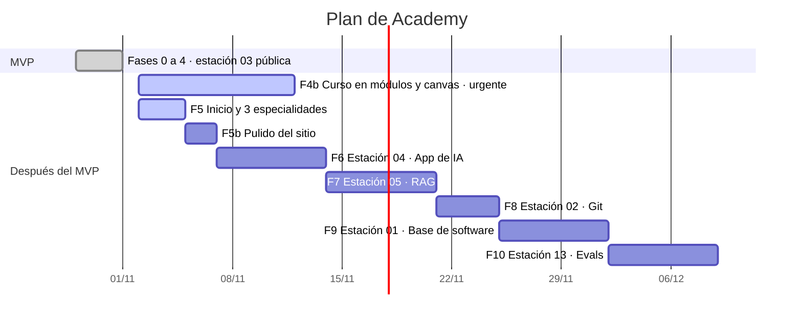

# Avance · Academy

El tablero del proyecto. Claude lo actualiza en cada entrega:
- marca lo hecho con [x], con la fecha;
- suma tu pedido al registro del final;
- cambia «Dónde estamos».

Si te pierdes, abre este archivo o pregunta «¿cómo vamos?».

*Última actualización: 2026-11-02*

---

## Dónde estamos

- **Avance:** `▓▓▓▓▓▓░░░░` 39 de 64 tareas del plan (61 %). El MVP está al 100 %. La Fase 5, «Inicio + 3 especialidades», va en 4 de 6.
- **Hecho:** Fases 0 a 4 y casi toda la 4b. El curso es público en https://academy.woorky.app/es/. **Desde el 2026-11-02, el borrador tiene la plataforma en 4 secciones**: Inicio, AI Engineering, ML y Deep Learning, y Data Science. Cada especialidad tiene su temario y su avance, y la lección 03 te lleva a los temas que siguen en las otras. Míralo en https://academy.woorky.app/borrador/es/
- **Falta:** tu OK al reparto de temas entre ML y Deep Learning y Data Science, y a publicar las 4 secciones. Sumar 2 videos a tu biblioteca (necesita tu sesión de NotebookLM). Después, el pulido (5b) y las fases 6 a 10.
- **Lo próximo:** revisa el borrador. Si te gusta, «dale publica»; si no, dime qué sección cambio.

**Cómo ver el avance:** cada respuesta de Claude en el chat termina con este resumen y con la carta Gantt de abajo. El tablero completo siempre está en https://github.com/francoSW99/Academy/blob/main/AVANCE.md.

## Plan de acción

```text
                                      oct S1  S2  S3  S4  S5  S6  S7
F0–4  MVP: estación 03 pública        ███
F4b   Curso en módulos + canvas           █████▓
F5    Inicio + 3 especialidades           ██▓
F5b   Pulido del sitio                        ░░
F6    Lección 04 · App de IA                      ░░░░
F7    Lección 05 · RAG                                ░░░░
F8    Lección 02 · Git                                    ░░
F9    Lección 01 · Base de software                         ░░░░
F10   Lección 13 · Evals                                        ░░░░
Después: 06–08 agentes · temas de ML y DS · inglés · UI             ···

█ hecho · ▓ lo próximo · ░ lo que viene
S1 = 2–8 nov · S2 = 9–15 · S3 = 16–22 · S4 = 23–29 · S5 = 30 nov–6 dic · S6 = 7–13 dic · S7 = 14–20 dic
```

Cada sesión es un día de trabajo con Claude. El plan supone unas 3 por semana y se ajusta cada semana.

### Por qué este orden

1. **Sigue los 5 niveles de la nota.** Las estaciones 03 y 04 cierran el nivel 1, «App con API». La 05 y la 13 cierran el nivel 2, «RAG con evals». La mayoría del trabajo útil en producción es de nivel 2 o 3.
2. **La 02 (Git) va antes que la 01.** Su material ya está escrito en la guía de estudio, y es lo que usas a diario con los agentes.
3. **Lo que faltaba del bloque 3 entra donde se usa:**
   - las salidas estructuradas, en la 04;
   - los embeddings, en la 05;
   - el tool use, en la 06.

### Decisiones que te tocan

1. **¿Publicas las 4 secciones?** Están en el borrador. Con «dale publica» pasan a `/es/`, y los links viejos siguen funcionando.
2. **¿Apruebas el reparto del Pilar 2?** Tu nota tenía ML, Deep Learning y Data Science juntos y en revisión. Los separé así:
   - **ML y Deep Learning** (18 lecciones): cómo aprende un modelo, los modelos típicos, deep learning, visión y lenguaje, LLMs por dentro, MLOps e investigación.
   - **Data Science** (13 lecciones): el mapa, los datos, estadística, series de tiempo y grupos, energía solar y neurociencia.
   - El bloque 26, «Mejorar sin re-entrenar», no se repite: ya está en AI Engineering (RAG, prompting y evals) y se conecta con un puente.
   - Si un tema te calza mejor en la otra especialidad, dime cuál y lo muevo.
3. **¿Apruebas este plan?** Si quieres otro orden, dime cuál y lo cambio.

### La carta Gantt con fechas (en GitHub se ve como gráfico)



---

## Plan del MVP (hecho)

El detalle de cada fase está en [docs/plan-mvp.md](docs/plan-mvp.md).

### ✅ Fase 0 · Bases del repo · 4 de 4 · 2026-10-29
- [x] Repo público en GitHub: https://github.com/francoSW99/Academy · 2026-10-29
- [x] Proyecto Next.js que genera un sitio estático (lo sirve Caddy, sin servidor nuevo) · 2026-10-29
- [x] El plan guardado en `docs/plan-mvp.md` · 2026-10-29
- [x] Script `npm run publicar`: arma el sitio y lo cambia de una vez, sin versiones a medias · 2026-10-29

### ✅ Fase 1 · Diseño · 4 de 4 · 2026-10-30 · PR #1
- [x] Tres primeras propuestas: A «Libro vivo», B «Universo» y C «Metro» · 2026-10-29
- [x] Tres vueltas más con tus comentarios: D, E y F · 29 y 30 de octubre
- [x] Elegiste **F · Pizarra en metro, en blanco**. Es una interfaz *provisional*: se rediseña después · 2026-10-30
- [x] `DESIGN.md` con colores, letras y movimiento, y las maquetas en `docs/diseno/` · 2026-10-30

### ✅ Fase 2 · Estructura del curso · 4 de 4 · 2026-10-30 · PR #2
- [x] Portada con el mapa de metro: Línea 1, 5 zonas y 16 estaciones. La Línea 2 se ve «en revisión» · 2026-10-30
- [x] Cada estación con sus 7 paradas: problema, mecanismo, criterio, cómo falla, sin la etiqueta, dirígelo y práctica · 2026-10-30
- [x] El avance se guarda en el navegador, sin login: paradas vistas y práctica hecha · 2026-10-30
- [x] La ruta como datos (`src/ruta/`): para abrir una estación se agrega su archivo de contenido · 2026-10-30

### ✅ Extra · Videos animados con ManimGX · 3 de 3 · 2026-10-30 · PR #3
- [x] ManimGX instalado, la herramienta de animación al estilo 3Blue1Brown · 2026-10-30
- [x] Tres videos de la estación 03 (paradas 1, 2 y 5), en pizarra blanca y negra · 2026-10-30
- [x] Script que los renderiza: `scripts/escenas.sh` · 2026-10-30

> Retirados del sitio el 2026-10-31 (pedido 28): las lecciones no llevan videos para mirar. ManimGX se queda para dibujar las piezas de los canvas (Fase 4b).

### ✅ Fase 3 · Lección del bloque 3 · 5 de 5 · 2026-10-31 · PR #4 y #5
- [x] **Córtalo en tokens** (parada 2):
  - cualquier texto cortado en tokens;
  - el español usa más tokens según el modelo: +69 % en GPT-3 y solo +4 % en GPT-4o.
  - 2026-10-31
- [x] **Tira los dados** (parada 2):
  - temperatura, top-k y top-p con probabilidades reales;
  - el modelo apuesta 48 % a Estambul, que es falso, como capital de Turquía.
  - 2026-10-31
- [x] **Llena la ventana** (parada 4):
  - una conversación que no cabe;
  - al recortar o resumir, el modelo olvida la alergia al maní.
  - 2026-10-31
- [x] **Lee rápido, escribe lento** (parada 3):
  - prefill y decode con tiempos reales;
  - un documento tarda 4 min 33 s en dar el primer token en esta máquina.
  - 2026-10-31
- [x] Práctica del bloque (parada 7): explicar por qué alucina un modelo y marcarla como hecha · 2026-10-30

### ✅ Fase 4 · Publicar · 3 de 3 · 2026-10-31
- [x] Cambiar el Caddyfile (`BrainFran/tools/academy/Caddyfile`): `/` lleva a `/es/` y `/obsidian/` queda igual · 2026-10-31
- [x] Armar la versión con `npm run publicar` y reiniciar el servicio `brainfran-academy` · 2026-10-31
- [x] Probar en internet: `/es/`, las 7 paradas, los videos, las escenas desde el celular y `/obsidian/` · 2026-10-31

---

## Fases después del MVP

### ▶ Fase 4b · Curso en módulos y lecciones, con canvas y videos de tu biblioteca · urgente · 12 de 13 · PR #7 a #10 mezclados
Pedidos 28 a 33. Los 3 videos de la estación 03 los hice yo con ManimGX para mirarlos, y eso no va. Las reglas:
1. **Nada de videos para mirar.** Lo que mostraban va como **canvas interactivo** y entretenido, como un gráfico o un dashboard que responde en tiempo real.
2. **ManimGX se queda, y se usa para los canvas**, al estilo de 3Blue1Brown.
3. **Nada se crea al abrir la página**, para que cargue rápido. ManimGX dibuja antes, en la VM, las fórmulas, los diagramas y los momentos. La página solo junta esas piezas y mueve con Motion lo que tocas. Meta: menos de 300 KB por canvas (el video de la parada 2 pesa 815 KB).
4. **Los videos que van en la app salen, cuando se pueda, de tu biblioteca de BrainFran** (`04-Biblioteca/Videos/`). Tocas la miniatura y el video se ve dentro de la app, o abres el enlace directo a YouTube. Van solo donde suman. Cada video, o el tramo que se muestra, trata solo del tema de la lección: los videos generales no van en una lección (pedido 41).
5. **Sin paradas** (pedido 33): el curso se ordena en módulos y lecciones, como DeepLearning.AI o Khan Academy.
6. **La lección se lee de corrido** (pedidos 35 y 37). Las ideas van en orden, cada una con su explicación, su escena y su ejemplo real en el mismo texto, sin recuadros que corten el hilo. Al final van los consejos de un ingeniero de IA experto, uno por idea. Es para aprender el criterio de un ingeniero de IA, no para redactar prompts simples.
7. **Visual, pero solo lo necesario** (pedidos 38, 39, 47 y 48): cada idea lleva un visual (diagrama, escena o canvas). Si ya tiene una escena, no se le suma un diagrama. Cada diagrama usa los ejemplos de la misma lección, no trae códigos ni números que haya que buscar en otra parte y no adelanta temas que todavía no se explicaron. Los diagramas van en HTML (el texto se lee en el celular y cargan al instante). ManimGX queda para las figuras matemáticas y los canvas.
8. **Ejemplos de ingeniero de IA** (pedido 40): los ejemplos y casos son usos reales y cotidianos de un ingeniero de IA (código, soporte, costos, RAG), medidos con un modelo. Nada de casos básicos o vagos.
9. **Fuentes** (pedido 42): cada idea y cada consejo dicen en qué se apoyan, y la lista completa va al final, con la fecha de revisión. Primero van los libros y videos de la biblioteca de BrainFran, después los videos de canales reconocidos y las mediciones propias. Solo páginas y capítulos verificados.

- [x] Sacar del sitio los 3 videos (paradas 1, 2 y 5) y corregir las reglas: `DESIGN.md` y este tablero, de inicio a fin · 2026-10-31
- [x] Diseñar los 3 canvas con ManimGX: el storyboard de cada uno quedó en `docs/diseno/canvas/`, espera tu OK antes de construir · 2026-10-31
- [x] Estructura nueva: la portada con el temario (módulos, lecciones, avance y «Continuar»), la lección en una página con barra lateral y las direcciones viejas que redirigen. Publicado · 2026-11-01
- [x] La lección 03 de corrido: las ideas en orden, cada una con su ejemplo real dentro del texto, y al final lo que haría un ingeniero de IA experto, uno por idea (pedidos 35 y 37). Publicado · 2026-11-01
- [x] Casos reales de un ingeniero de IA en la lección 03: un bot de soporte que escribe «Ya hemos cancelado la recurrencia» sin que nadie lo hiciera, el presupuesto en tokens (el español usa un 63 % más en GPT-3), tickets que cambian de categoría o se clasifican mal con seguridad (74 %), el plan del cliente que se pierde al recortar, y el manual entero que tarda 5 min 10 s en empezar. Medidos con el modelo local, también en las escenas (pedido 40). Publicado · 2026-11-01
- [x] Videos de la lección 03 solo del tema: 3Blue1Brown y Andrej Karpathy, que tratan solo de cómo funciona un LLM, y de Marina Wyss solo el tramo del 2:45 al 8:30. BettaTech salió: solo nombra el tema de pasada (pedido 41). Publicado · 2026-11-01
- [ ] Sumar a tu biblioteca los 2 videos nuevos (3Blue1Brown y Karpathy): la sesión de NotebookLM del servidor venció, así que hace falta que vuelvas a entrar con tu cuenta
- [x] Fuentes en cada lección: cada idea y cada consejo dicen en qué se apoyan (libro con página, video con capítulo o medición propia), y la lista completa va al final, con la fecha de revisión. Las principales son el libro «Prompt Engineering for Generative AI», de tu biblioteca, y las mediciones de `lab/` (pedido 42). Publicado · 2026-11-01
- [x] Visuales solo donde hacen falta, no un flowchart por idea (pedidos 47 y 48): la lección 03 queda como en el sitio. El bucle va en la idea 1, que no tenía escena, y las ideas 2 a 5 ya tienen la suya. Los diagramas de tokens, ventana y leer/escribir se probaron en el borrador y se quitaron · 2026-11-01
- [x] Los 3 canvas con los casos nuevos (pedido 49). Dos ya estaban hechos en la escena de los dados: «Pregúntale otra vez» es «Tirar 100 veces» con los tickets, y «La pizarra por momentos» son las probabilidades, el dado y la temperatura. Hacerlos otra vez repetía lo mismo. El que faltaba es «Escribe como el bot» (idea 1): eliges cada palabra de la respuesta a Carla entre las 3 más probables y la probabilidad de la frase se multiplica en vivo. Se armó directo en HTML con los datos de `lab/autocompletado`; los storyboards viejos de `docs/diseno/canvas/` quedan solo como historia · 2026-11-01
- [x] Videos de tu biblioteca: tocas la miniatura y se ve en la app, o vas directo a YouTube. Hoy son los 3 videos del tema de la lección 03 (ver más arriba). Publicado · 2026-11-01
- [x] Publicar el curso en módulos y la lección 03 nueva, revisados en computador y celular (pedido 43) · 2026-11-01
- [x] Publicado en https://academy.woorky.app/es/leccion/03/ y revisado en computador y celular (pedido 49) · 2026-11-01

### ▶ Fase 5 · Inicio y 3 especialidades · 4 de 6 · semana 1 · en el borrador
Pedido 51. La plataforma se separa en 4 secciones, para no mezclar temas ni marear al estudiante:
1. **Inicio:** qué es Academy, cuál especialidad elegir y cómo se conectan.
2. **AI Engineering**, **ML y Deep Learning** y **Data Science:** cada una con su sección, su temario y su avance. Cambias de una a otra cuando quieras, desde la barra de arriba.
3. **Conectadas por dentro:** cada tema vive en una sola especialidad. Los temas compartidos son puentes entre lecciones (`src/ruta/conexiones.ts`). Al final de la lección se muestran con el color y el nombre de la otra especialidad.

- [x] Los datos: las 3 especialidades con su temario (`src/ruta/especialidades.ts`) y 18 puentes entre lecciones (`src/ruta/conexiones.ts`). Un puente roto no deja armar el sitio · 2026-11-02
- [x] El Inicio: qué es Academy, una tarjeta por especialidad («Elígela si…») y cómo se conectan · 2026-11-02
- [x] La sección de cada especialidad, con su temario y su avance, y la barra de arriba con las 4 secciones (cabe en el celular) · 2026-11-02
- [x] La lección 03 dentro de AI Engineering (`/es/ai-engineering/leccion/03/`), con «Conecta con otras especialidades» al final. Los links viejos redirigen y el avance que ya tenías se conserva · 2026-11-02
- [ ] Tu OK al reparto del Pilar 2 entre ML y Deep Learning y Data Science (ver «Decisiones que te tocan»)
- [ ] Publicar en `/es/`

### Fase 5b · Pulido del sitio · 0 de 3 · semana 2
- [ ] Ícono del sitio (favicon): hoy no hay y el navegador da un error 404
- [ ] Página «no encontrada» en español: hoy sale la de Next.js, en inglés
- [ ] Vista previa al compartir el link: título, descripción e imagen en WhatsApp o LinkedIn

**Diagnóstico de UI y UX · 2026-10-31.** Hecho con capturas del sitio en vivo, en escritorio (1440 px) y en celular (390 px). Se vuelve tareas cuando elijas A o B:
1. **Una parada es una página muy larga.** La parada 2 mide 3.000 px en escritorio y 4.000 en el celular: un video y 2 escenas dentro de una sola pizarra. `DESIGN.md` pide una idea por pizarra.
2. **En el celular no se ve en qué parada estás.** La línea de paradas muestra solo de la 1 a la 3. En la parada 6, la tuya queda fuera de la pantalla.
3. **No retoma donde quedaste.** «Entrar a la estación» siempre lleva a la parada 1, y la portada no muestra cuántas paradas viste.
4. **El video tapa su propia frase.** Los controles del video cubren la última línea de la escena («Elige por probabilidad, no por verdad»).
5. **El mapa tiene ruido para quien llega.** Las etiquetas «L2 · 27–28» salen en 8 estaciones sin explicación, y las 15 estaciones cerradas no dicen «pronto».
- Con la estructura nueva (Fase 4b) se arreglan el 2, el 3 y el 5; el 4 ya se fue con los videos.
- Detalles menores: la cabecera ocupa 2 filas en el celular, falta el selector «Blanca | Negra» que pide `DESIGN.md` y la portada dice «1 abierta(s)».

### Fase 6 · Estación 04 «Arquitectura de una app de IA» · 0 de 4 · semanas 1 y 2
- [ ] Las 7 paradas, con el contenido de la nota (bloque 4)
- [ ] 1 o 2 canvas interactivos con ManimGX, uno con salidas estructuradas
- [ ] Videos de tu biblioteca, solo donde suman
- [ ] Publicada en el sitio

### Fase 7 · Estación 05 «RAG y conocimiento» · 0 de 4 · semanas 2 y 3
- [ ] Las 7 paradas (bloque 5)
- [ ] 1 o 2 canvas interactivos con ManimGX: embeddings (texto → vector) y búsqueda
- [ ] Videos de tu biblioteca, solo donde suman
- [ ] Publicada en el sitio

### Fase 8 · Estación 02 «Git y GitHub para dirigir al agente» · 0 de 3 · semana 3
- [ ] Las 7 paradas, desde la guía de estudio de Git (ya escrita)
- [ ] 1 canvas interactivo
- [ ] Publicada en el sitio

### Fase 9 · Estación 01 «Base de software habilitadora» · 0 de 4 · semana 4
- [ ] Las 7 paradas (bloque 1)
- [ ] 1 o 2 canvas interactivos con ManimGX
- [ ] Videos de tu biblioteca, solo donde suman
- [ ] Publicada en el sitio

### Fase 10 · Estación 13 «Evals: saber si funciona» · 0 de 4 · semana 5
- [ ] Las 7 paradas (bloque 13)
- [ ] 1 o 2 canvas interactivos con ManimGX
- [ ] Videos de tu biblioteca, solo donde suman
- [ ] Publicada en el sitio

### Más adelante (sin fecha)
- [ ] Estaciones 06 a 08: agentes y harnesses (nivel 3), con tool use
- [ ] Inglés (`/en/`), con «traducir al tocar»
- [ ] Rediseño de la interfaz a tu gusto: la actual es provisional
- [ ] Enlaces a las notas del grafo desde cada lección (necesita un cambio en BrainFran)
- [ ] Lo que queda del bloque 3: modelos que razonan, cómo se entrena en 3 pasos y modelos abiertos vs. cerrados

---

## Registro: lo que pediste y lo que se entregó

| # | Fecha | Lo que pediste | Lo que se entregó |
|---|---|---|---|
| 1 | 2026-10-29 | Planificar la plataforma, sin tocar código | Plan en 5 fases (`docs/plan-mvp.md`) |
| 2 | 2026-10-29 | Elegir: 1.ª lección, acceso, idiomas y diseño | 1.ª lección «Cómo funciona un LLM», pública sin login, español primero, y mockups para elegir |
| 3 | 2026-10-29 | «Dale fase 1, repo público» | Repo público, base del proyecto (Fase 0) y propuestas A, B y C |
| 4 | 29 oct | Más minimal y futurista, como DeepMind o Woorky, con la letra de Woorky, en claro y oscuro | Propuesta D «Metro minimal», en claro y en oscuro |
| 5 | 29 oct | Más elegante, como una pizarra digital (3Blue1Brown, Khan Academy); la portada se entendía poco | Propuesta E «Pizarra digital» |
| 6 | 30 oct | El estilo de E con el orden de metro de C | Propuesta F «Pizarra en metro» |
| 7 | 2026-10-30 | «F pero en blanco, pizarra» | F en blanco elegida y `DESIGN.md` (PR #1) |
| 8 | 2026-10-30 | Que la interfaz sea provisional y se priorice el curso | Anotado: colores cambiables en un solo lugar |
| 9 | 2026-10-30 | «Dale mezcla» | PR #1 mezclado |
| 10 | 2026-10-30 | «Dale fase 2» y «Continúa» | Mapa, estaciones, 7 paradas y avance (PR #2) |
| 11 | 2026-10-30 | Instalar ManimGX y usarlo siempre | ManimGX instalado y revisado |
| 12 | 2026-10-30 | Mezclar el PR 2 y mejorar las clases con ManimGX | PR #2 mezclado y 3 videos animados (PR #3) |
| 13 | 2026-10-30 | «Mezcla el PR 3» | PR #3 mezclado |
| 14 | 2026-10-31 | «Dale fase 3» | Escena «Tira los dados» |
| 15 | 2026-10-31 | «Sigue» | Escena «Córtalo en tokens» |
| 16 | 2026-10-31 | «Sigue» | Escena «Llena la ventana» |
| 17 | 2026-10-31 | «Mezcla el PR 4» | PR #4 mezclado |
| 18 | 2026-10-31 | «Sigue» | Escena «Lee rápido, escribe lento» (PR #5) |
| 19 | 2026-10-31 | «Mezcla el PR 5» | PR #5 mezclado: Fase 3 completa |
| 20 | 2026-10-31 | Un archivo para seguir el avance, porque estabas perdido | Este tablero, `AVANCE.md` (PR #6) |
| 21 | 2026-10-31 | Ver el tablero cada vez que se termina un trabajo y recibir el resumen «Dónde estamos» | El link fijo al tablero y el resumen al final de cada entrega (PR #6) |
| 22 | 2026-10-31 | Ver el avance aquí, en el chat de Claude Code, en cada respuesta | Cada respuesta termina con «Dónde estamos». Un hook de Claude Code le pasa este tablero a Claude en cada mensaje tuyo |
| 23 | 2026-10-31 | «Mezcla el PR 6» | PR #6 mezclado: el tablero queda en `main`, con link fijo |
| 24 | 2026-10-31 | «Dale publica todo» | Sitio público en https://academy.woorky.app/es/ (Fase 4). MVP terminado |
| 25 | 2026-10-31 | Saber qué camino sigue y ver el plan siempre claro, tipo carta Gantt | Plan de acción F5–F10 con carta Gantt en el tablero y al final de cada respuesta |
| 26 | 2026-10-31 | Ver «Dónde estamos» y la carta Gantt en cualquier proyecto, no solo en Academy | Hook global de Claude Code: en cada repo lee su `AVANCE.md`, y si no hay, pide crearlo |
| 27 | 2026-10-31 | Trabajar ahora en la UI y la UX: «prepárate» | Diagnóstico del sitio en vivo (escritorio y celular): 5 problemas de uso y la decisión A o B |
| 28 | 2026-10-31 | Sacar los videos que hizo Claude: lo animado va como canvas interactivo con motion, y los videos son originales de YouTube de canales educativos, solo donde suman. Un plan antes de corregir | Plan de la Fase 4b (6 pasos, unas 2 sesiones). La regla quedó anotada en la memoria de Claude |
| 29 | 2026-10-31 | «Noo desinstales ManimGX»: canvas interactivos y entretenidos, como gráficos o dashboards en tiempo real, con ayuda de ManimGX al estilo de 3Blue1Brown, pero sin crearlos en tiempo real para que la app cargue rápido. Los videos: ideas de la biblioteca de BrainFran, con vista previa y enlace directo | Plan de la Fase 4b corregido: ManimGX dibuja antes y la página solo arma y responde; tarjetas de la biblioteca. ManimGX sigue instalado (no se desinstaló) |
| 30 | 2026-10-31 | Los videos no son para sacar ideas para los canvas: solo hay que intentar sacarlos de la biblioteca de BrainFran. Al tocar la miniatura se ve el video en la app, o se va por enlace directo a YouTube | Plan de la Fase 4b corregido: paso 4, videos de la biblioteca que se ven en la app, con enlace a YouTube |
| 31 | 2026-10-31 | «Dale» al plan corregido de la Fase 4b | Paso 1 publicado: los 3 videos fuera del sitio y las reglas corregidas en `DESIGN.md` y en el tablero. Paso 2: storyboards de los 3 canvas con ManimGX y datos reales. Paso 4: videos de tu biblioteca con miniatura y enlace, sin publicar (PR #8) |
| 32 | 2026-11-01 | Cambiar el mecanismo de enseñanza de 7 paradas: ¿algún sustituto? | Tres opciones, con la recomendada: «3 paradas» (Apuesta → Descubre → Dirige) |
| 33 | 2026-11-01 | Sin apuesta ni paradas: directo al grano, como DeepLearning.AI o Khan Academy. Primero la teoría, después un ejemplo de la vida real, y cómo usarlo para ser preciso al darle un prompt a un LLM como Claude. «Tal vez módulos» | Propuesta: curso → módulos → lecciones; cada lección en una página con 3 partes. La Fase 4b pasa a 7 tareas |
| 34 | 2026-11-01 | «Dale, créalo para ver cómo queda en la página» | Borrador en https://academy.woorky.app/borrador/es/: temario por módulos y la lección 03 en 3 partes. El sitio público no cambió |
| 35 | 2026-11-01 | Los módulos sí; las 3 partes de la lección no: confunden, no se ve dónde empieza el caso real y el prompt de la parte 3 no sirve. Es para aprender el criterio de un ingeniero de IA, no para redactar prompts simples | Propuesta: la lección por ideas, con su caso real y lo que hace un ingeniero de IA, todo junto |
| 36 | 2026-11-01 | «Dale, hazlo en borrador para ver tu idea» | La lección 03 por ideas en el borrador: 5 ideas, cada una con su caso real y lo que hace un ingeniero de IA, más el resumen, la práctica, preguntas para tu LLM y los videos |
| 37 | 2026-11-01 | Los recuadros «Caso real» y «Lo que hace un ingeniero de IA» cortan el hilo del estudio; los consejos de experto sí sirven. «Proponme algo» | La lección de corrido en el borrador: el ejemplo real va dentro del texto de cada idea, y los consejos de un ingeniero de IA experto van al final, uno por idea, con un enlace de vuelta a la idea |
| 38 | 2026-11-01 | Más imágenes, gráficos, canvas o flowcharts entre los textos, para no aburrirse y poder imaginar lo que dice el texto | 2 diagramas de muestra en el borrador (el bucle de un LLM y cómo arma un ingeniero una llamada) y el plan para el resto: al menos un visual por idea |
| 39 | 2026-11-01 | El flowchart de «lo que haría un ingeniero de IA» confunde: no se entiende el ejemplo del cliente ni los números 1, 4, 5 | Quitado del borrador. Reglas para los diagramas: los ejemplos de la lección, sin códigos que buscar y sin adelantar temas |
| 40 | 2026-11-01 | Que los ejemplos y casos sean usos reales y cotidianos de un ingeniero de IA, no casos básicos y vagos | Propuesta: 5 casos de ingeniero de IA para la lección 03, medidos con el modelo local, también en las escenas |
| 41 | 2026-11-01 | Antes de aplicar: los videos de «Para profundizar» son demasiado generales para «Cómo funciona un LLM»; tienen que estar más semantizados | Propuesta: solo el tramo del tema de cada video de tu biblioteca, y 2 videos que tratan solo de cómo funciona un LLM, sumados a tu biblioteca |
| 42 | 2026-11-01 | «Dale perfecto». Y antes de implementar, citas o bibliografía con fuentes confiables, ojalá de los libros y fuentes de BrainFran | En el borrador: los casos reales medidos, los videos del tema (3Blue1Brown, Karpathy y el tramo de Marina Wyss) y las fuentes en cada idea y al final, con el libro de tu biblioteca |
| 43 | 2026-11-01 | «Dale, sí me gusta» | Publicado en https://academy.woorky.app/es/: el temario por módulos y la lección 03 nueva. Revisado en internet: la portada, la lección, los links viejos y `/obsidian/` |
| 44 | 2026-11-01 | ¿Por qué cambió el dashboard? ¿Se genera al abrir la página y gasta tokens? | No: el sitio es estático y no llama a ningún modelo (revisado en lo publicado). Cambió porque hoy se publicaron los casos nuevos. Los datos se midieron una vez con el modelo local, sin costo por visita |
| 45 | 2026-11-01 | «Mezcla el PR 7 y el 8» | PR #7 y #8 mezclados: `main` queda igual que el sitio publicado, y el link de este tablero muestra el estado de hoy |
| 46 | 2026-11-01 | «Sigue» | Los 3 diagramas que faltaban en la lección 03 (tokens, ventana, leer y escribir), en el borrador (PR #9) |
| 47 | 2026-11-01 | La escena de tokens ya le gustaba como está en el sitio: no todo tiene que ser flowchart, solo lo necesario | Quitado el diagrama de tokens: la idea 2 queda igual que en el sitio. Regla anotada: un visual solo donde la idea no tiene uno |
| 48 | 2026-11-01 | «Sí, sácalos»: la lección como está publicada | Quitados los diagramas de ventana y de leer/escribir. El código de la lección es igual al del sitio |
| 49 | 2026-11-01 | «Mezcla el PR 9, redibuja lo que falta de los 3 canvas con los casos nuevos y sube todo a prod» | PR #9 mezclado. Canvas «Escribe como el bot» en la idea 1; los otros 2 ya estaban en la escena de los dados. Publicado (PR #10) |
| 50 | 2026-11-02 | «Mezcla el PR 10»; la Fase 5, en otra conversación | PR #10 mezclado: `main` es igual al sitio. La Fase 5 sigue en una conversación nueva |
| 51 | 2026-11-02 | Reestructurar la página entera: una sección para cada especialidad (AI Engineering, ML/Deep Learning y Data Science) más un Inicio que presente la plataforma. Separadas en la interfaz y conectadas por dentro, para no confundir qué tema es de cuál | Las 4 secciones en el borrador (https://academy.woorky.app/borrador/es/), con los puentes entre lecciones. El Pilar 2 quedó repartido entre ML y DL y Data Science, a la espera de tu OK. El pulido pasa a la Fase 5b |

---

## Dónde está cada cosa

- **El curso:** https://academy.woorky.app/es/ (el grafo de BrainFran sigue en https://academy.woorky.app/obsidian/).
  - Las especialidades y sus temarios están en `src/ruta/especialidades.ts`, y los puentes entre ellas, en `src/ruta/conexiones.ts`.
  - Para publicar una versión nueva: `npm run publicar` en la VM. Las últimas 3 versiones quedan en `versiones/` para volver atrás.
- **El código:** https://github.com/francoSW99/Academy
- **Las entregas:** cada una es un PR, en la pestaña *Pull requests* del repo. Del #1 al #10 ya están mezclados: el #7 es la publicación del MVP y el #8, el curso en módulos. El #9 solo actualiza este tablero y también está mezclado. El #10 trae el canvas «Escribe como el bot».
- **Los diseños A a F:** https://claude.ai/artifact/NcPw19s4bfwHF2K6gmyTvW
- **Los datos reales de las escenas:** `lab/`, con un README por escena.
- **El temario completo:** la nota de BrainFran `03-Proyectos/Ideas/Plataforma Interactiva de Aprendizaje Visual.md`.
