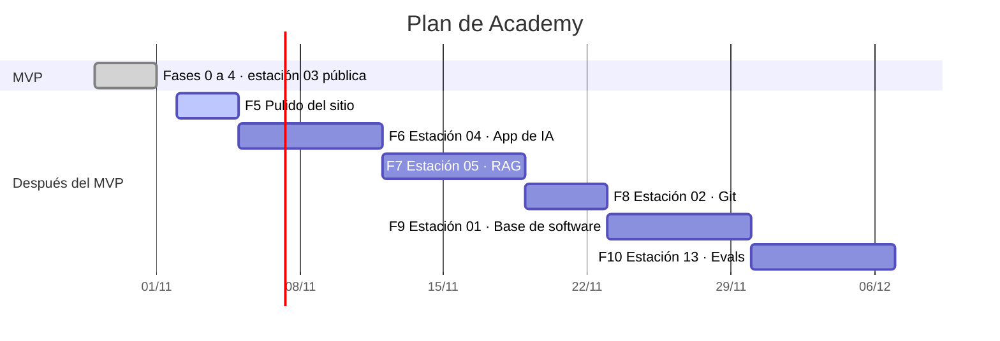

# Avance · Academy

El tablero del proyecto. Claude lo actualiza en cada entrega:
- marca lo hecho con [x], con la fecha;
- suma tu pedido al registro del final;
- cambia «Dónde estamos».

Si te pierdes, abre este archivo o pregunta «¿cómo vamos?».

*Última actualización: 2026-10-31*

---

## Dónde estamos

- **Avance:** `▓▓▓▓▓░░░░░` 23 de 45 tareas del plan (51 %). El MVP está al 100 %.
- **Hecho:** Fases 0 a 4. La estación 03, «Cómo funciona un LLM», es pública en https://academy.woorky.app/es/ desde el 2026-10-31.
- **Falta:** las fases 5 a 10: el pulido del sitio y 5 estaciones más, unas 5 semanas.
- **Lo próximo:** F5 · Pulido del sitio (1 sesión): ícono, página «no encontrada» en español y vista previa al compartir el link.

**Cómo ver el avance:** cada respuesta de Claude en el chat termina con este resumen y con la carta Gantt de abajo. El tablero completo siempre está en https://github.com/francoSW99/Academy/blob/main/AVANCE.md.

## Plan de acción

```text
                                      oct S1  S2  S3  S4  S5  S6
F0–4  MVP: estación 03 pública        ███
F5    Pulido del sitio                    ▓▓
F6    Estación 04 · App de IA               ░░░░
F7    Estación 05 · RAG                         ░░░░
F8    Estación 02 · Git                             ░░
F9    Estación 01 · Base de software                  ░░░░
F10   Estación 13 · Evals                                 ░░░░
Después: 06–08 agentes · inglés · UI                          ···

█ hecho · ▓ lo próximo · ░ lo que viene
S1 = 2–8 nov · S2 = 9–15 · S3 = 16–22 · S4 = 23–29 · S5 = 30 nov–6 dic · S6 = 7–13 dic
```

Cada sesión es un día de trabajo con Claude. El plan supone unas 3 por semana y se ajusta cada semana.

### Por qué este orden

1. **Sigue los 5 niveles de la nota.** Las estaciones 03 y 04 cierran el nivel 1, «App con API». La 05 y la 13 cierran el nivel 2, «RAG con evals». La mayoría del trabajo útil en producción es de nivel 2 o 3.
2. **La 02 (Git) va antes que la 01.** Su material ya está escrito en la guía de estudio, y es lo que usas a diario con los agentes.
3. **Lo que faltaba del bloque 3 entra donde se usa:**
   - las salidas estructuradas, en la 04;
   - los embeddings, en la 05;
   - el tool use, en la 06.

### Decisiones que te tocan

1. **¿Apruebas este plan?** Si quieres otro orden, dime cuál y lo cambio.

### La carta Gantt con fechas (en GitHub se ve como gráfico)



---

## Plan del MVP (hecho)

El detalle de cada fase está en [docs/plan-mvp.md](docs/plan-mvp.md).

### ✅ Fase 0 · Bases del repo · 4 de 4 · 2026-10-29
- [x] Repo público en GitHub: https://github.com/francoSW99/Academy · 2026-10-29
- [x] Proyecto Next.js que genera un sitio estático (lo sirve Caddy, sin servidor nuevo) · 2026-10-29
- [x] El plan guardado en `docs/plan-mvp.md` · 2026-10-29
- [x] Script `npm run publicar`: arma el sitio y lo cambia de una vez, sin versiones a medias · 2026-10-29

### ✅ Fase 1 · Diseño · 4 de 4 · 2026-10-30 · PR #1
- [x] Tres primeras propuestas: A «Libro vivo», B «Universo» y C «Metro» · 2026-10-29
- [x] Tres vueltas más con tus comentarios: D, E y F · 29 y 30 de octubre
- [x] Elegiste **F · Pizarra en metro, en blanco**. Es una interfaz *provisional*: se rediseña después · 2026-10-30
- [x] `DESIGN.md` con colores, letras y movimiento, y las maquetas en `docs/diseno/` · 2026-10-30

### ✅ Fase 2 · Estructura del curso · 4 de 4 · 2026-10-30 · PR #2
- [x] Portada con el mapa de metro: Línea 1, 5 zonas y 16 estaciones. La Línea 2 se ve «en revisión» · 2026-10-30
- [x] Cada estación con sus 7 paradas: problema, mecanismo, criterio, cómo falla, sin la etiqueta, dirígelo y práctica · 2026-10-30
- [x] El avance se guarda en el navegador, sin login: paradas vistas y práctica hecha · 2026-10-30
- [x] La ruta como datos (`src/ruta/`): para abrir una estación se agrega su archivo de contenido · 2026-10-30

### ✅ Extra · Videos animados con ManimGX · 3 de 3 · 2026-10-30 · PR #3
- [x] ManimGX instalado, la herramienta de animación al estilo 3Blue1Brown · 2026-10-30
- [x] Tres videos de la estación 03 (paradas 1, 2 y 5), en pizarra blanca y negra · 2026-10-30
- [x] Script que los renderiza: `scripts/escenas.sh` · 2026-10-30

### ✅ Fase 3 · Lección del bloque 3 · 5 de 5 · 2026-10-31 · PR #4 y #5
- [x] **Córtalo en tokens** (parada 2):
  - cualquier texto cortado en tokens;
  - el español usa más tokens según el modelo: +69 % en GPT-3 y solo +4 % en GPT-4o.
  - 2026-10-31
- [x] **Tira los dados** (parada 2):
  - temperatura, top-k y top-p con probabilidades reales;
  - el modelo apuesta 48 % a Estambul, que es falso, como capital de Turquía.
  - 2026-10-31
- [x] **Llena la ventana** (parada 4):
  - una conversación que no cabe;
  - al recortar o resumir, el modelo olvida la alergia al maní.
  - 2026-10-31
- [x] **Lee rápido, escribe lento** (parada 3):
  - prefill y decode con tiempos reales;
  - un documento tarda 4 min 33 s en dar el primer token en esta máquina.
  - 2026-10-31
- [x] Práctica del bloque (parada 7): explicar por qué alucina un modelo y marcarla como hecha · 2026-10-30

### ✅ Fase 4 · Publicar · 3 de 3 · 2026-10-31
- [x] Cambiar el Caddyfile (`BrainFran/tools/academy/Caddyfile`): `/` lleva a `/es/` y `/obsidian/` queda igual · 2026-10-31
- [x] Armar la versión con `npm run publicar` y reiniciar el servicio `brainfran-academy` · 2026-10-31
- [x] Probar en internet: `/es/`, las 7 paradas, los videos, las escenas desde el celular y `/obsidian/` · 2026-10-31

---

## Fases después del MVP

### ▶ Fase 5 · Pulido del sitio · 0 de 3 · semana 1
- [ ] Ícono del sitio (favicon): hoy no hay y el navegador da un error 404
- [ ] Página «no encontrada» en español: hoy sale la de Next.js, en inglés
- [ ] Vista previa al compartir el link: título, descripción e imagen en WhatsApp o LinkedIn

### Fase 6 · Estación 04 «Arquitectura de una app de IA» · 0 de 4 · semanas 1 y 2
- [ ] Las 7 paradas, con el contenido de la nota (bloque 4)
- [ ] 1 o 2 videos con ManimGX
- [ ] 1 o 2 escenas interactivas, una con salidas estructuradas
- [ ] Publicada en el sitio

### Fase 7 · Estación 05 «RAG y conocimiento» · 0 de 4 · semanas 2 y 3
- [ ] Las 7 paradas (bloque 5)
- [ ] 1 o 2 videos con ManimGX
- [ ] 1 o 2 escenas interactivas: embeddings (texto → vector) y búsqueda
- [ ] Publicada en el sitio

### Fase 8 · Estación 02 «Git y GitHub para dirigir al agente» · 0 de 3 · semana 3
- [ ] Las 7 paradas, desde la guía de estudio de Git (ya escrita)
- [ ] 1 escena interactiva
- [ ] Publicada en el sitio

### Fase 9 · Estación 01 «Base de software habilitadora» · 0 de 4 · semana 4
- [ ] Las 7 paradas (bloque 1)
- [ ] 1 o 2 videos con ManimGX
- [ ] 1 o 2 escenas interactivas
- [ ] Publicada en el sitio

### Fase 10 · Estación 13 «Evals: saber si funciona» · 0 de 4 · semana 5
- [ ] Las 7 paradas (bloque 13)
- [ ] 1 o 2 videos con ManimGX
- [ ] 1 o 2 escenas interactivas
- [ ] Publicada en el sitio

### Más adelante (sin fecha)
- [ ] Estaciones 06 a 08: agentes y harnesses (nivel 3), con tool use
- [ ] Inglés (`/en/`), con «traducir al tocar»
- [ ] Rediseño de la interfaz a tu gusto: la actual es provisional
- [ ] Enlaces a las notas del grafo desde cada lección (necesita un cambio en BrainFran)
- [ ] Lo que queda del bloque 3: modelos que razonan, cómo se entrena en 3 pasos y modelos abiertos vs. cerrados

---

## Registro: lo que pediste y lo que se entregó

| # | Fecha | Lo que pediste | Lo que se entregó |
|---|---|---|---|
| 1 | 2026-10-29 | Planificar la plataforma, sin tocar código | Plan en 5 fases (`docs/plan-mvp.md`) |
| 2 | 2026-10-29 | Elegir: 1.ª lección, acceso, idiomas y diseño | 1.ª lección «Cómo funciona un LLM», pública sin login, español primero, y mockups para elegir |
| 3 | 2026-10-29 | «Dale fase 1, repo público» | Repo público, base del proyecto (Fase 0) y propuestas A, B y C |
| 4 | 29 oct | Más minimal y futurista, como DeepMind o Woorky, con la letra de Woorky, en claro y oscuro | Propuesta D «Metro minimal», en claro y en oscuro |
| 5 | 29 oct | Más elegante, como una pizarra digital (3Blue1Brown, Khan Academy); la portada se entendía poco | Propuesta E «Pizarra digital» |
| 6 | 30 oct | El estilo de E con el orden de metro de C | Propuesta F «Pizarra en metro» |
| 7 | 2026-10-30 | «F pero en blanco, pizarra» | F en blanco elegida y `DESIGN.md` (PR #1) |
| 8 | 2026-10-30 | Que la interfaz sea provisional y se priorice el curso | Anotado: colores cambiables en un solo lugar |
| 9 | 2026-10-30 | «Dale mezcla» | PR #1 mezclado |
| 10 | 2026-10-30 | «Dale fase 2» y «Continúa» | Mapa, estaciones, 7 paradas y avance (PR #2) |
| 11 | 2026-10-30 | Instalar ManimGX y usarlo siempre | ManimGX instalado y revisado |
| 12 | 2026-10-30 | Mezclar el PR 2 y mejorar las clases con ManimGX | PR #2 mezclado y 3 videos animados (PR #3) |
| 13 | 2026-10-30 | «Mezcla el PR 3» | PR #3 mezclado |
| 14 | 2026-10-31 | «Dale fase 3» | Escena «Tira los dados» |
| 15 | 2026-10-31 | «Sigue» | Escena «Córtalo en tokens» |
| 16 | 2026-10-31 | «Sigue» | Escena «Llena la ventana» |
| 17 | 2026-10-31 | «Mezcla el PR 4» | PR #4 mezclado |
| 18 | 2026-10-31 | «Sigue» | Escena «Lee rápido, escribe lento» (PR #5) |
| 19 | 2026-10-31 | «Mezcla el PR 5» | PR #5 mezclado: Fase 3 completa |
| 20 | 2026-10-31 | Un archivo para seguir el avance, porque estabas perdido | Este tablero, `AVANCE.md` (PR #6) |
| 21 | 2026-10-31 | Ver el tablero cada vez que se termina un trabajo y recibir el resumen «Dónde estamos» | El link fijo al tablero y el resumen al final de cada entrega (PR #6) |
| 22 | 2026-10-31 | Ver el avance aquí, en el chat de Claude Code, en cada respuesta | Cada respuesta termina con «Dónde estamos». Un hook de Claude Code le pasa este tablero a Claude en cada mensaje tuyo |
| 23 | 2026-10-31 | «Mezcla el PR 6» | PR #6 mezclado: el tablero queda en `main`, con link fijo |
| 24 | 2026-10-31 | «Dale publica todo» | Sitio público en https://academy.woorky.app/es/ (Fase 4). MVP terminado |
| 25 | 2026-10-31 | Saber qué camino sigue y ver el plan siempre claro, tipo carta Gantt | Plan de acción F5–F10 con carta Gantt en el tablero y al final de cada respuesta |

---

## Dónde está cada cosa

- **El curso:** https://academy.woorky.app/es/ (el grafo de BrainFran sigue en https://academy.woorky.app/obsidian/).
  - Para publicar una versión nueva: `npm run publicar` en la VM. Las últimas 3 versiones quedan en `versiones/` para volver atrás.
- **El código:** https://github.com/francoSW99/Academy
- **Las entregas:** cada una es un PR, en la pestaña *Pull requests* del repo. Del #1 al #6 ya están mezclados, y el #7 marca la publicación.
- **Los diseños A a F:** https://claude.ai/artifact/NcPw19s4bfwHF2K6gmyTvW
- **Los datos reales de las escenas:** `lab/`, con un README por escena.
- **El temario completo:** la nota de BrainFran `03-Proyectos/Ideas/Plataforma Interactiva de Aprendizaje Visual.md`.
